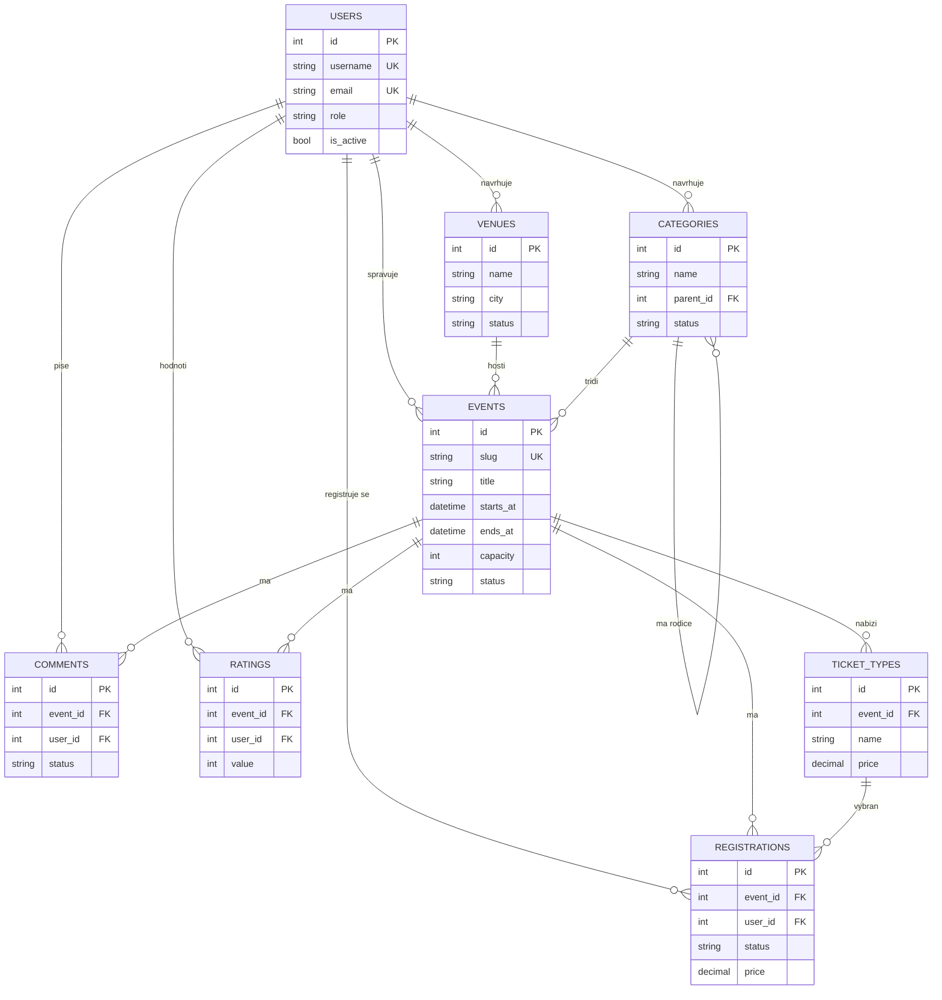
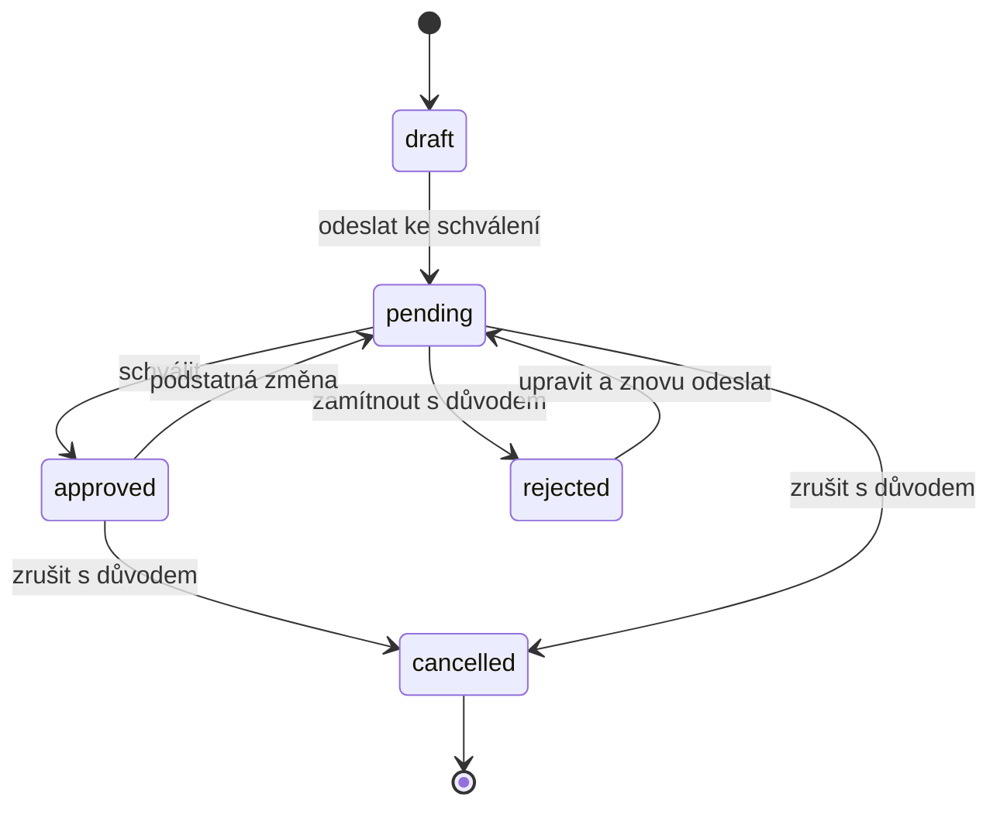
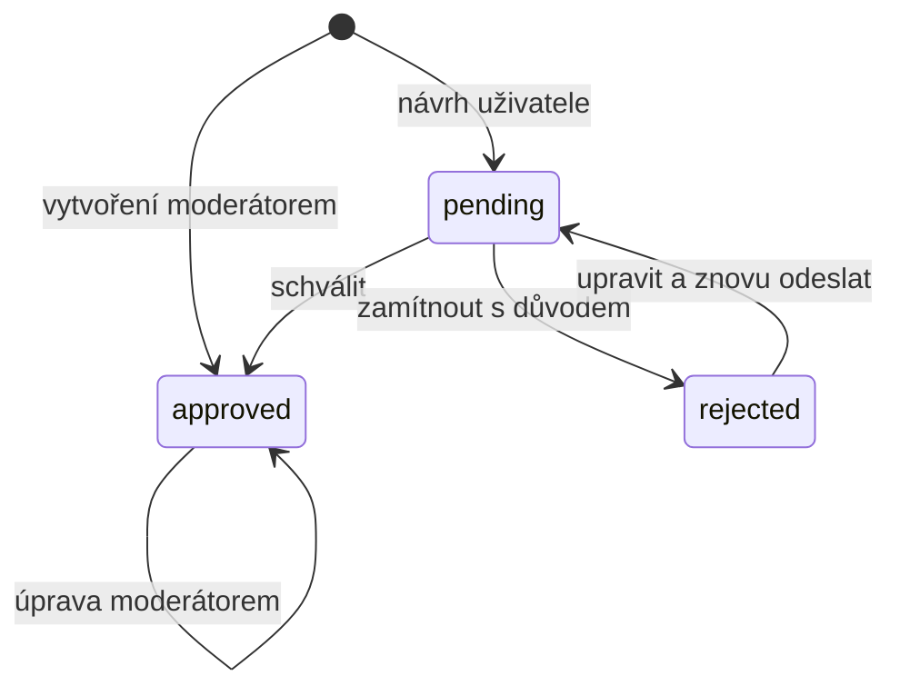
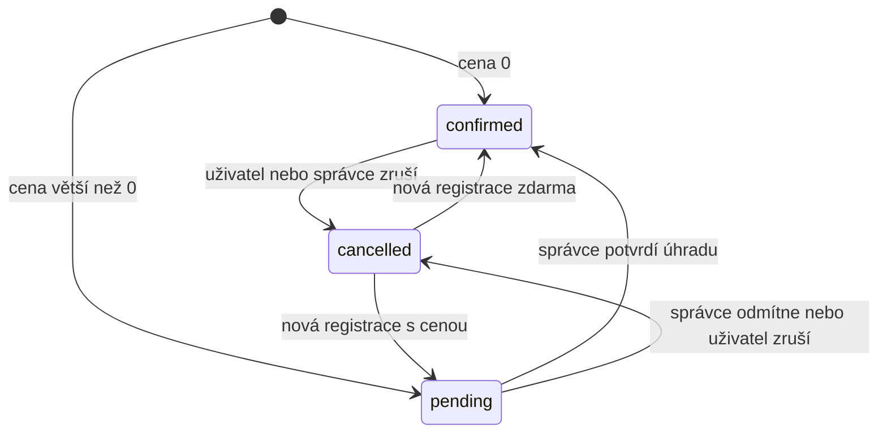
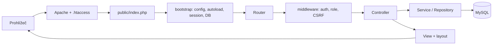

# Implementační plán projektu IIS: systém pro správu událostí

**Verze:** 1.1 (větev `laravel`), výchozí plán 1.0 · **Datum:** 17. 11. 2026
**Repozitář:** https://github.com/lukas-dudek/IIS
**Odevzdání:** nejpozději 22. 11. 2026 23:59, aplikace funkční minimálně do 13. 12. 2026

## Tým a odpovědnosti

| Člen | Role v týmu | Hlavní odpovědnost |
|---|---|---|
| Lukáš Dudek | vedoucí, backend | jádro aplikace, autentizace, správa uživatelů, katalog míst a kategorií, deployment, bezpečnost, dokumentace |
| Honzík (doplnit příjmení a login) | backend + frontend | události, vyhledávání, registrace a vstupenky, platby, kalendář, komentáře a hodnocení |

Oba jsme vývojáři a oba reviewujeme cizí změny. Lukáš vede tým a odevzdává projekt, ale obsahově odpovídáme za celek oba. U každé oblasti je uveden vlastník a recenzent; pravidla pro zásah do cizích souborů jsou v kapitole 12.

> Tento dokument je závazný zdroj pravdy pro člověka i pro AI asistenty. Pokud se zadání (`zadani.md`, `spec-zadani.md`) a plán rozcházejí, platí zadání a plán se musí opravit. `AGENTS.md` obsahuje trvalá pravidla pro vývoj a práci s AI.

---

## 0. Jak dokument číst

- **P0** je povinné pro odevzdání a plný počet bodů. **P1** je kvalita a obhajitelnost, dělá se po P0. **P2** je volitelné rozšíření, pouze pokud je hotové P0 a P1 a zbývá čas.
- **UC-** jsou případy použití, **BR-** business pravidla, **M-** milníky.
- **A** je Lukáš, **B** je Honzík.
- Každý úkol má v GitHub issue odkaz na UC/BR, vlastníka a akceptační kritéria. Bez toho se nezačíná.
- Kapitoly 2, 7 a 8 popisují větvi `laravel`. Kde se nástroje liší, je u bodu výslovně uvedena i varianta původní větve `feat/loop-p0` (`app/Core`, `config/routes.php`, `database/schema.sql`, PDO). Doménová pravidla v kapitolách 4–6 platí pro obě větve stejně.

---

## 1. Cíl a hranice projektu

### 1.1 Cíl

Dodat použitelný informační systém pro správu událostí přesně podle varianty zadání, nasazený na veřejně dostupné adrese, s ukázkovými daty, dokumentací, videem a obhajitelným kódem. Cílové hodnocení je plný počet bodů, tedy nejen funkčnost, ale i návrh, konzistence dat, ošetření vstupů, použitelnost a schopnost oba členové vysvětlit řešení.

### 1.2 Kvalitativní cíle

1. **Správnost:** žádná operace nesmí uvést databázi do nekonzistentního stavu; kapacity, schvalování a platby jsou transakční.
2. **Použitelnost:** každá role má v rozhraní dostupnou každou svoji činnost; uživatel nikdy neopisuje ID cizího klíče.
3. **Bezpečnost:** autentizace, autorizace, CSRF, ochrana proti SQL injection a XSS, bezpečný upload.
4. **Vysvětlitelnost:** jednoduchá architektura bez zbytečných abstrakcí; každý řádek musí umět jeho autor obhájit.
5. **Dokončenost:** P0 hotové nejpozději 16. 11. 2026, zbytek je QA, dokumentace, video a buffer.

### 1.3 Omezení a předpoklady

- Dvoučlenný tým, přibližně 3 týdny práce, oba studenti mají i jiné povinnosti. Počítáme s 80–100 hodinami na osobu.
- Předpokládáme, že tým a varianta jsou už zapsané; termín pro změny týmů 4. 10. 2026 je za námi. Pokud zápis chybí, je to riziko číslo jedna a řeší se hned.
- Povolené a doporučené prostředí: PHP 8.1 na serveru Eva, MySQL/MariaDB, Apache, HTML5 + CSS + JavaScript.
- SQLite a nerelační databáze jsou zakázané. Další serverová technologie by vyžadovala vlastní hosting; to je zbytečné riziko.
- Oba budeme používat generativní AI. Odpovědnost za kód tím nezaniká; AI je nástroj, ne autor.
- Repozitář je privátní, oba mají push práva. Přesné FIT loginy doplníme do dokumentace při odevzdání.
- Aplikace poběží na Evě; případný jiný hosting je záložní plán, ne první volba.

### 1.4 Co projekt nedělá

- Online platební brána, automatické párování bankovních plateb, e-mailové notifikace, SMS, ověřování e-mailu.
- Google Calendar OAuth a automatický import cizích událostí. Místo toho nabídneme export do `.ics`, který lze do Google kalendáře importovat.
- Mobilní aplikace, vícejazyčné rozhraní, tmavý režim, waitlist, galerie více fotek, auditní log. Některé z toho jsou P2, ale nesmějí ohrozit P0.
- Redakční systém nebo hotová administrace. Veškeré obrazovky a oprávnění implementujeme sami.

### 1.5 Jak čteme zadání (důležitá rozhodnutí)

| Požadavek | Naše interpretace | Dopad |
|---|---|---|
| unikátní označení události | název nemusí být unikátní, ale každá událost má unikátní `slug` do URL a čitelný kód `U-RRRR-NNNN` odvozený z ID | dvě události stejného názvu jdou rozlišit |
| kapacita omezená/neomezená | `events.capacity = NULL` znamená neomezeno, jinak kladné celé číslo | jedna logika pro obě varianty |
| volitelné vstupné, více kategorií | každá událost má alespoň jeden typ vstupenky; cena 0 znamená zdarma; placená je událost, kde je alespoň jeden typ s cenou > 0 | model `ticket_types` |
| místo konání | adresa je definující: ulice a město povinné, PSČ, popis a fotka nepovinné | uživatel nevyplňuje zbytečnosti |
| hierarchické kategorie | `parent_id`, maximální hloubka 4, vyhledávání podle kategorie zahrne i potomky | jednoduchý strom, žádná closure tabulka |
| správce události | není to globální role, ale oprávnění uživatele, který událost založil (`events.manager_id`) | uživatel může spravovat jen svoje události |
| potvrzení úhrady předem | správce události označí registraci jako zaplacenou; žádná platební brána | stav `pending` → `confirmed` |
| hodnocení a komentáře po ukončení | pouze účastník s potvrzenou registrací a pouze po `ends_at` | kontrola data i registrace |
| osobní kalendář | přehled potvrzených registrací a spravovaných událostí + export `.ics` | splňuje i návrh rozšíření |
| rozšíření: Google kalendář | export `.ics` místo OAuth integrace | méně rizika, reálně použitelné |
| rozšíření: import reálných událostí | záměrně neimplementujeme | zdroje jsou nespolehlivé a nad rámec P0 |

---

## 2. Technologická rozhodnutí

### 2.1 Zvolený stack (větev `laravel`, aktuální)

| Vrstva | Volba | Verze | Odůvodnění |
|---|---|---|---|
| Frontend | HTML5, CSS, JavaScript | evergreen | požadavek zadání |
| CSS/JS framework | Bootstrap | 5.3.3, lokálně v `public/assets/vendor/` | povolený, dostupné komponenty, žádný build step ani CDN |
| Backend | PHP + Laravel | 8.1 / Laravel 10.50 | Laravel 10 je poslední řada podporující PHP 8.1 na Evě |
| Architektura | Laravel MVC: routy, controllery, Blade, service vrstva | – | zadání framework výslovně připouští |
| Databáze | MySQL/MariaDB, InnoDB, `utf8mb4` | testováno 10.11 | relační model, shodné se zadáním |
| Přístup k DB | Eloquent + migrace, `lockForUpdate()` pro zámky | Laravel 10 | transakce a vázané parametry bez ručního SQL |
| Testy | PHPUnit 10 nad MySQL testovací databází | ^10.5 | SQLite je zakázaný, testy běží na stejném enginu |
| CI | GitHub Actions: lint + PHPUnit | – | rychlá zpětná vazba |
| Verzování | Git + GitHub, privátní repo | – | doporučeno zadáním |

**Závislosti.** Jediná runtime závislost je `laravel/framework`; `vendor/` se do odevzdávaného archivu
nedává (zadání zakazuje odevzdávat kódy cizích knihoven), jeho obsah se instaluje přes Composer a verze
jsou v `doc.html`. Bootstrap zůstává lokální soubor, bez CDN a bez Node/build stepu.

### 2.2 Původní varianta (větev `feat/loop-p0`)

Větev `feat/loop-p0` obsahuje první implementaci ve vlastním malém MVC: PHP 8.1, PDO, `config/routes.php`,
`database/schema.sql`, `database/seed.sql`, vlastní `app/Core` a PHP šablony. Ta varianta zůstává
v repozitáři, ale dál se nerozvíjí.

| Vrstva | Volba |
|---|---|
| Architektura | vlastní malé MVC, front controller |
| Přístup k DB | PDO, prepared statements |
| Šablony | vlastní `View` a PHP šablony |
| Závislosti | žádné runtime Composer závislosti |

### 2.3 Zamítnuté alternativy

| Alternativa | Proč ne |
|---|---|
| Nette, Symfony | další frameworková vrstva bez přínosu pro tento rozsah; Laravel je nejlépe dokumentovaný |
| Node.js/Django/Java | podmínka vlastního hostingu a riziko, že aplikace nepoběží na Evě |
| React/Vue | build step, duplikace logiky, zbytečná složitost pro serverové formuláře |
| SQLite | zakázáno zadáním, navíc jiné chování zámků |
| MongoDB a jiné NoSQL | zakázáno zadáním |
| Docker v produkci | Eva je přirozené prostředí; Docker slouží jen k lokálnímu spuštění |

**Cena rozhodnutí.** Framework přináší hotové routování, session, CSRF a autorizaci, ale je potřeba
umět vysvětlit každou vrstvu. Proto zůstávají tenké controllery, service vrstva s explicitními pravidly
a testy pro každý přechod stavu. Složitější architektura podle zadání automaticky neznamená lepší hodnocení.

### 2.3 Ověření prostředí hned první den

- [ ] Verze PHP na Evě (`php -v`), dostupnost `fileinfo`, GD, `mbstring`, `pdo_mysql`.
- [ ] Verze MySQL/MariaDB, dostupné collation `utf8mb4_czech_ci`, chování `CHECK` constraintů.
- [ ] Zda lze v `~/WWW` použít symlink na `~/iis/public`; pokud ne, zvolit záložní variantu z kapitoly 15.
- [ ] `.htaccess`: rewrite, UTF-8, přístupová práva, zákaz spuštění PHP v uploads.
- [ ] Session save path, časové pásmo, zápis do `storage/`.
- [ ] Testovací stránka s připojením k DB a výpisem verze musí běžet přes HTTPS/HTTP na veřejné URL.

---

## 3. Rozsah a priority

### 3.1 P0: povinné

| ID | Funkce | Zdroj | Vlastník |
|---|---|---|---|
| F-01 | registrace, přihlášení, odhlášení, timeout relace | zadání 3 | A |
| F-02 | role admin/moderator/user, autorizace, správa uživatelů | zadání 3, spec | A |
| F-03 | katalog míst: návrh, schválení, správa, detail | spec | A |
| F-04 | kategorie: strom, návrh, schválení, správa | spec | A |
| F-05 | události: koncept, úprava, odeslání, schválení, zamítnutí, zrušení | spec | B |
| F-06 | typy vstupenek, kapacity, ceny | spec | B |
| F-07 | veřejný seznam, detail, vyhledávání a filtry | spec | B |
| F-08 | registrace na událost, kapacita, čekání na platbu | spec | B |
| F-09 | potvrzení úhrady správcem, zrušení registrace | spec | B |
| F-10 | osobní kalendář a export `.ics` | spec | B |
| F-11 | komentáře a hodnocení po ukončení, moderace komentářů | spec | B + A |
| F-12 | moderace událostí, míst a kategorií | spec | A |
| F-13 | validace, zachování formulářů, povinná/nepovinná pole | zadání 3 | oba |
| F-14 | bezpečnost: CSRF, session, práva, XSS, SQLi, upload | zadání 3, 4 | A |
| F-15 | nasazení na Evu, ukázková data, dokumentace, video | zadání 5, 6 | oba |

### 3.2 P1: kvalita nad rámec minima

- Titulní fotka události a fotka místa (jeden obrázek, ne galerie).
- Varování moderátora na kolizi dvou událostí ve stejném místě a čase.
- Tlačítko „Uhradil jsem“ pro uživatele a přehled těchto tvrzení pro správce.
- Prázdné stavy, aktivní filtry, stránkování, přístupnost formulářů.
- GitHub Actions lint + unit testy.
- Ověřený import ICS do Google kalendáře.

### 3.3 P2: pouze po M3 a pouze pokud nehrozí odevzdání

- Waitlist při plné kapacitě.
- Více fotek (galerie) u událostí a míst.
- In-app notifikace a auditní log.
- Nahlášení komentáře uživatelem.
- Statistiky pro správce události (obsazenost, tržby).
- Tmavý režim.

**Pravidlo řezu:** 16. 11. 2026 se zastavuje vývoj P2. Pokud není hotové P0 nebo P1, P2 se ruší bez diskuse. Rozsah se nikdy nerozšiřuje na úkor dokumentace, videa a testů.

---

## 4. Role a oprávnění

### 4.1 Role

| Role | Popis | V DB |
|---|---|---|
| neregistrovaný uživatel | prochází schválené události a katalog | není řádek, jen session bez přihlášení |
| registrovaný uživatel | registruje se, spravuje profil, zakládá události, navrhuje místa a kategorie | `users.role = 'user'` |
| správce události | vzniká založením události, není to globální role | `events.manager_id` |
| moderátor | schvaluje události, místa, kategorie; spravuje katalog; moderuje komentáře | `users.role = 'moderator'` |
| administrátor | má všechna práva moderátora a navíc správu uživatelů | `users.role = 'admin'` |

Hierarchie pro kontrolu role: `admin > moderator > user`. Správce události se kontroluje vždy vůči konkrétní události, nikdy jen podle globální role. Admin může spravovat jakoukoli událost, moderátor ne; moderátor schvaluje, ale neupravuje cizí obsah události.

### 4.2 Matice oprávnění

| Činnost | Host | Uživatel | Správce své události | Moderátor | Admin |
|---|---|---|---|---|---|
| procházet schválené události | ano | ano | ano | ano | ano |
| zobrazit detail schválené události | ano | ano | ano | ano | ano |
| registrovat se na událost | ne | ano | ano | ano | ano |
| zrušit vlastní registraci | ne | ano | ano | ano | ano |
| komentovat a hodnotit po ukončení | ne | jen účastník | jen účastník | jen účastník | jen účastník |
| založit událost | ne | ano | – | ano | ano |
| upravit událost | ne | ne | ano, jen svou | ne | ano |
| odeslat událost ke schválení | ne | ne | ano, jen svou | ne | ano |
| zrušit událost | ne | ne | ano, jen svou | ne | ano |
| zobrazit účastníky a potvrzovat platby | ne | ne | ano, jen své | ne | ano |
| navrhnout místo nebo kategorii | ne | ano | ano | ano | ano |
| schválit/zamítnout událost | ne | ne | ne | ano | ano |
| schválit/zamítnout místo či kategorii | ne | ne | ne | ano | ano |
| spravovat schválený katalog míst a kategorií | ne | ne | ne | ano | ano |
| moderovat komentáře | ne | ne | ne | ano | ano |
| spravovat uživatele a role | ne | ne | ne | ne | ano |
| vidět moderátorské fronty | ne | ne | ne | ano | ano |

### 4.3 Pravidla autorizace

- Každá routa s akcí má middleware `auth` a podle potřeby `role:moderator` nebo `role:admin`.
- Každý přístup k záznamu navíc kontroluje vlastnictví nebo roli: `event.manager_id`, `venue.proposed_by`, `comment.user_id`.
- Vlastník události nikdy nerozhoduje o schválení své události; schvaluje moderátor nebo admin.
- Admin nesmí zneužít roli k obcházení business pravidel (např. registrace na vlastní akci jako účastník je technicky možná, ale nesmí obejít kapacitu).
- Neaktivní účet se chová jako nepřihlášený; existující relace se invalidují zvýšením `auth_version`.
- Všechny kontroly jsou na serveru. Skrytí tlačítka v UI není autorizace.

---

## 5. Případy použití

### 5.1 Přehled

| ID | Případ použití | Aktér | P | Vlastník | Klíčový výsledek |
|---|---|---|---|---|---|
| UC-01 | Registrace uživatele | host | P0 | A | vznikne aktivní účet role `user` |
| UC-02 | Přihlášení, odhlášení, timeout | všichni | P0 | A | bezpečná relace, automatické odhlášení |
| UC-03 | Procházení a vyhledávání událostí | host | P0 | B | seznam s filtry a stránkováním |
| UC-04 | Detail události | host | P0 | B | všechny údaje, stav, vstupenky, komentáře |
| UC-05 | Správa profilu a hesla | uživatel | P0 | A | změna údajů, invalidace relací |
| UC-06 | Vytvoření události a vstupenek | uživatel | P0 | B | koncept nebo odeslaná událost |
| UC-07 | Odeslání události ke schválení | správce | P0 | B | stav `pending`, fronta moderátora |
| UC-08 | Úprava a zrušení události | správce | P0 | B | změny dle stavu, zrušení s dopadem na registrace |
| UC-09 | Návrh místa konání | uživatel | P0 | A | místo `pending`, fronta moderátora |
| UC-10 | Návrh kategorie | uživatel | P0 | A | kategorie `pending`, kontrola stromu |
| UC-11 | Registrace na událost | uživatel | P0 | B | `confirmed` nebo `pending` dle ceny |
| UC-12 | Potvrzení úhrady | správce | P0 | B | `pending` → `confirmed` |
| UC-13 | Zrušení registrace | uživatel/správce | P0 | B | uvolnění místa, stav `cancelled` |
| UC-14 | Osobní kalendář a export | uživatel | P0 | B | přehled a `.ics` |
| UC-15 | Komentář a hodnocení | účastník | P0 | B | jeden komentář, jedno hodnocení |
| UC-16 | Moderace událostí | moderátor | P0 | A | schválení/zamítnutí s odůvodněním |
| UC-17 | Moderace a správa míst | moderátor | P0 | A | schválení, úprava, bezpečné mazání |
| UC-18 | Moderace a správa kategorií | moderátor | P0 | A | strom, přesun, bezpečné mazání |
| UC-19 | Moderace komentářů | moderátor | P0 | A | skrytí/zobrazení s důvodem |
| UC-20 | Správa uživatelů a rolí | admin | P0 | A | CRUD, deaktivace, role, reset hesla |
| UC-21 | Přehled mých návrhů | uživatel | P1 | A | stav návrhů míst a kategorií |
| UC-22 | Varování na kolizi místa | moderátor | P1 | B | informace, ne automatický zákaz |

### 5.2 Detailní toky

#### UC-06 až UC-08: životní cyklus události

1. Přihlášený uživatel otevře „Moje události“ a zvolí „Nová událost“.
2. Formulář předvyplní začátek na nejbližší celou hodinu a konec na +2 hodiny. Uživatel vybere schválené místo a kategorii ze seznamu, vyplní název, popis, volitelnou kapacitu a alespoň jeden typ vstupenky.
3. „Uložit koncept“ provede validaci povinných polí a uloží stav `draft`. Koncept je viditelný jen správci a adminovi.
4. „Odeslat ke schválení“ znovu zvaliduje vše včetně budoucnosti začátku, kapacity a typů vstupenek. Událost přejde do `pending`, nastaví `submitted_at` a objeví se ve frontě moderátora.
5. Moderátor vidí detail, správce, místo, kategorii, vstupenky, obsazenost a případná varování na kolizi. Schválí (`approved`) nebo zamítne s povinným odůvodněním (`rejected`).
6. Zamítnutou událost může správce upravit a znovu odeslat; odůvodnění se zobrazí.
7. Po schválení lze měnit popis a fotku bez nového schvalování. Podstatná změna (název, čas, místo, kategorie, kapacita, typy vstupenek) vrátí událost do `pending`; existující registrace zůstávají a UI je informuje, že událost čeká na opětovné schválení.
8. Zrušení události je možné ve `draft`, `pending` a `approved`. Zrušením se všechny aktivní registrace přepnou na `cancelled`; událost zmizí z veřejného seznamu, ale zůstane dostupná správci, účastníkům a adminovi s vysvětlujícím bannerem.

#### UC-09 a UC-10: návrhy do katalogu

1. Uživatel otevře formulář místa nebo kategorie, ideálně v nové kartě, aby nepřišel o rozpracovanou událost.
2. Místo: název, ulice, město povinné; PSČ, popis a fotka nepovinné. Kategorie: název, volitelný rodič z schválených kategorií, popis nepovinný.
3. Návrh vznikne jako `pending` s `proposed_by`. Navrhovatel ho vidí v „Moje návrhy“ a může ho upravit, dokud je `pending` nebo `rejected`; po schválení ho upravuje jen moderátor.
4. Moderátor schválí nebo zamítne s odůvodněním. Schválené místo/kategorie se ihned nabízí ve formuláři události.
5. Kategorii nelze schválit, pokud její rodič není schválený. Nelze vytvořit cyklus ani překročit hloubku 4.
6. Mazání je možné jen u nepoužívaných záznamů; pokud je záznam použitý v události nebo má potomky, systém operaci odmítne s vysvětlením.

#### UC-11 až UC-13: registrace a platba

1. Událost musí být `approved`, nesmí být po začátku a nesmí být zrušená. Host je přesměrován na přihlášení s bezpečným `return` parametrem.
2. Uživatel vybere právě jeden typ vstupenky formou radio karet s cenou a dostupností. Zadávání ID je vyloučeno.
3. Server v jedné transakci zamkne řádek události (`SELECT ... FOR UPDATE`), ověří stav, čas, duplicitní registraci, kapacitu události a kapacitu typu vstupenky, uloží snapshot ceny a rozhodne:
   - cena 0: stav `confirmed` ihned;
   - cena > 0: stav `pending`, vygeneruje se `variable_symbol`, zobrazí se platební instrukce z `events.payment_note`.
4. Do kapacity se počítají `pending` i `confirmed`. `cancelled` místo uvolňuje.
5. Uživatel po platbě klikne na „Uhradil jsem“; nastaví se `payment_claimed_at`, stav zůstává `pending`.
6. Správce události vidí účastníky, jejich typ vstupenky, cenu, VS a tvrzení o platbě. Potvrzením se stav změní na `confirmed` a uloží se `decided_by`, `decided_at`; odmítnutím na `cancelled`.
7. Uživatel může zrušit registraci do začátku události. Stejný řádek se při opětovné registraci znovu použije, ale historii nezachováváme; to je vědomé zjednodušení.
8. Snížení kapacity pod počet aktivních registrací je zakázané. Mazání typu vstupenky s registracemi je zakázané; změna ceny platí jen pro budoucí registrace díky snapshotu.

#### UC-14: kalendář

1. Kalendář zobrazuje události, kde je uživatel `confirmed` účastník, a události, které spravuje, v měsíční mřížce a seznamu.
2. Šipkami se mění měsíc; výchozí je aktuální měsíc v `Europe/Prague`.
3. Export `.ics` obsahuje aktivní události se stabilním UID `event-<id>@<host>`, kde host je z konfigurace aplikace (fallback `iis.local`), UTC časy, název, místo, popis a URL. Ověříme import do Google kalendáře.
4. Zrušené události se v kalendáři nezobrazují; proběhlé se zobrazí v daném měsíci, ale ne v exportu budoucích akcí.

#### UC-15: komentáře a hodnocení

1. Formulář se zobrazí jen účastníkovi s `confirmed` registrací po `ends_at` události.
2. Hodnocení 1–5 je povinné, komentář nepovinný (1–2000 znaků). Ukládá se jedno hodnocení na uživatele a událost; opakované odeslání ho aktualizuje.
3. Komentář může autor upravit nebo smazat. Moderátor ho může skrýt s povinným důvodem a znovu zobrazit. Skryté komentáře se nezobrazují veřejně; průměr se počítá pouze z hodnocení, ne z komentářů.
4. Průměr a počet hodnocení se zobrazí u události a v seznamu.

#### UC-16 až UC-19: moderace

1. Moderátorský dashboard ukazuje počty čekajících událostí, míst, kategorií a skrytých komentářů.
2. Fronta událostí je řazená podle `submitted_at`, zobrazuje správce, místo, kategorii, termín, kapacitu a varování na kolizi. Schválení/zamítnutí je vždy potvrzené a zamítnutí vyžaduje odůvodnění.
3. Fronta míst a kategorií zobrazuje navrhovatele a stav. Moderátor může rovnou vytvořit nové místo/kategorii, která je schválená okamžitě, a upravovat schválené záznamy.
4. Správa kategorií je strom s indikací hloubky; přesun hlídá cyklus a hloubku, mazání hlídá potomky a použití v událostech.
5. Moderace komentářů je seznam s filtrem podle události a stavu; skrytí vyžaduje důvod, zobrazení je jednoklikové s potvrzením.

#### UC-20: správa uživatelů

1. Admin vidí seznam s hledáním, filtrem role a stavu aktivity.
2. Vytvoření vyžaduje unikátní uživatelské jméno a e-mail, jméno, roli a počáteční heslo. Editace umožní změnu údajů, role a reset hesla.
3. Deaktivace je preferovaná před smazáním. Smazání je možné jen u uživatele bez referencí (události, registrace, komentáře, hodnocení, návrhy); jinak systém nabídne deaktivaci.
4. Admin nesmí deaktivovat nebo smazat sám sebe a nesmí odebrat poslednímu aktivnímu adminovi roli.
5. Deaktivace a změna hesla zvyšují `auth_version`, čímž zneplatní existující relace.

---

## 6. Datový model

### 6.1 Zásady

- InnoDB, `utf8mb4`, collation `utf8mb4_czech_ci` (ověřit na Evě; fallback `utf8mb4_unicode_ci`).
- Všechny cizí klíče mají explicitní chování `RESTRICT`, `SET NULL` nebo `CASCADE` podle pravidla níže.
- Peníze jsou `DECIMAL(10,2)`, nikdy `FLOAT`.
- Časy ukládáme v UTC (`DATETIME`), aplikace je zobrazuje v `Europe/Prague`. Připojení nastaví `time_zone = '+00:00'`. Vstupy z formulářů se parsují jako `Europe/Prague` a před uložením převádějí na UTC; výstup se převádí zpět.
- `created_at`/`updated_at` jsou `DATETIME` s `CURRENT_TIMESTAMP`; čas vkládá aplikace v UTC, aby chování bylo stejné lokálně i na Evě.
- Historie ceny vstupenky je snapshot v registraci, ne odkaz na aktuální cenu.
- Uživatele nemažeme na tvrdo, pokud mají reference; primární je deaktivace.
- `CHECK` constrainty používáme, ale nespoléháme na ně: MySQL 5.7 je ignoruje, proto je stejná kontrola v aplikaci.

### 6.2 ER diagram



### 6.3 Tabulky

#### `users`

| Sloupec | Typ | NULL | Pravidlo |
|---|---|---|---|
| `id` | INT UNSIGNED AI | ne | PK |
| `username` | VARCHAR(50) | ne | unikátní, 3–50, `[a-zA-Z0-9_.-]` |
| `email` | VARCHAR(254) | ne | unikátní, platný formát, lowercase |
| `password_hash` | VARCHAR(255) | ne | `password_hash`, nikdy plaintext |
| `name` | VARCHAR(120) | ne | zobrazované jméno |
| `role` | ENUM('admin','moderator','user') | ne | default `user` |
| `is_active` | TINYINT(1) | ne | default 1 |
| `auth_version` | INT UNSIGNED | ne | default 1, invalidace relací |
| `created_at` | DATETIME | ne | UTC |
| `updated_at` | DATETIME | ne | UTC |
| `last_login_at` | DATETIME | ano | UTC |

Indexy: `username`, `email`, `(role, is_active)`.

#### `venues`

| Sloupec | Typ | NULL | Pravidlo |
|---|---|---|---|
| `id` | INT UNSIGNED AI | ne | PK |
| `name` | VARCHAR(120) | ne | název místa |
| `street` | VARCHAR(120) | ne | ulice a číslo |
| `city` | VARCHAR(80) | ne | město |
| `postal_code` | VARCHAR(10) | ano | formát `123 45` nebo `12345` |
| `description` | TEXT | ano | max 2000 |
| `photo_path` | VARCHAR(255) | ano | relativní cesta v uploads |
| `status` | ENUM('pending','approved','rejected') | ne | default `pending` |
| `proposed_by` | INT UNSIGNED | ne | FK users RESTRICT |
| `reviewed_by` | INT UNSIGNED | ano | FK users SET NULL |
| `reviewed_at` | DATETIME | ano | UTC |
| `rejection_reason` | VARCHAR(255) | ano | povinné při zamítnutí |
| `created_at`, `updated_at` | DATETIME | ne | UTC |

Indexy: `(status, city)`, `proposed_by`, `reviewed_by`.

#### `categories`

| Sloupec | Typ | NULL | Pravidlo |
|---|---|---|---|
| `id` | INT UNSIGNED AI | ne | PK |
| `name` | VARCHAR(80) | ne | název |
| `slug` | VARCHAR(100) | ne | unikátní, generovaný |
| `parent_id` | INT UNSIGNED | ano | FK categories RESTRICT, žádný cyklus |
| `description` | TEXT | ano | max 2000 |
| `status` | ENUM('pending','approved','rejected') | ne | default `pending` |
| `proposed_by` | INT UNSIGNED | ne | FK users RESTRICT |
| `reviewed_by` | INT UNSIGNED | ano | FK users SET NULL |
| `reviewed_at` | DATETIME | ano | UTC |
| `rejection_reason` | VARCHAR(255) | ano | povinné při zamítnutí |
| `created_at`, `updated_at` | DATETIME | ne | UTC |

Indexy: `slug`, `(parent_id, status)`, `proposed_by`.

#### `events`

| Sloupec | Typ | NULL | Pravidlo |
|---|---|---|---|
| `id` | INT UNSIGNED AI | ne | PK |
| `slug` | VARCHAR(180) | ne | unikátní, URL |
| `title` | VARCHAR(140) | ne | název |
| `description` | TEXT | ne | 20–5000 znaků |
| `starts_at` | DATETIME | ne | UTC, začátek |
| `ends_at` | DATETIME | ne | UTC, musí být > `starts_at` |
| `venue_id` | INT UNSIGNED | ne | FK venues RESTRICT, jen approved |
| `category_id` | INT UNSIGNED | ne | FK categories RESTRICT, jen approved |
| `capacity` | INT UNSIGNED | ano | NULL = neomezeno, jinak > 0 |
| `cover_path` | VARCHAR(255) | ano | jeden obrázek |
| `payment_note` | TEXT | ano | pokyny k platbě, max 1000 |
| `status` | ENUM('draft','pending','approved','rejected','cancelled') | ne | default `draft` |
| `manager_id` | INT UNSIGNED | ne | FK users RESTRICT |
| `submitted_at` | DATETIME | ano | pro řazení fronty |
| `reviewed_by` | INT UNSIGNED | ano | FK users SET NULL |
| `reviewed_at` | DATETIME | ano | UTC |
| `rejection_reason` | VARCHAR(255) | ano | povinné při zamítnutí |
| `cancelled_reason` | VARCHAR(255) | ano | povinné při zrušení |
| `created_at`, `updated_at` | DATETIME | ne | UTC |

Indexy: `(status, starts_at)`, `(category_id, starts_at)`, `(venue_id, starts_at)`, `manager_id`, `submitted_at`.
Check: `ends_at > starts_at`, `capacity IS NULL OR capacity > 0`.

#### `ticket_types`

| Sloupec | Typ | NULL | Pravidlo |
|---|---|---|---|
| `id` | INT UNSIGNED AI | ne | PK |
| `event_id` | INT UNSIGNED | ne | FK events CASCADE |
| `name` | VARCHAR(60) | ne | unikátní v rámci události |
| `price` | DECIMAL(10,2) | ne | >= 0, default 0 |
| `capacity` | INT UNSIGNED | ano | NULL = bez limitu typu |
| `created_at`, `updated_at` | DATETIME | ne | UTC |

Unique: `(event_id, name)`. Check: `price >= 0`, `capacity IS NULL OR capacity > 0`.
Pravidla: před odesláním musí existovat alespoň jeden typ; typ s registracemi nelze smazat; cena se snapshotuje.

#### `registrations`

| Sloupec | Typ | NULL | Pravidlo |
|---|---|---|---|
| `id` | INT UNSIGNED AI | ne | PK |
| `event_id` | INT UNSIGNED | ne | FK events RESTRICT |
| `user_id` | INT UNSIGNED | ne | FK users RESTRICT |
| `ticket_type_id` | INT UNSIGNED | ne | FK ticket_types RESTRICT |
| `status` | ENUM('pending','confirmed','cancelled') | ne | `pending` = čeká na platbu |
| `price` | DECIMAL(10,2) | ne | snapshot ceny v okamžiku registrace |
| `variable_symbol` | CHAR(10) | ano | unikátní, jen placené registrace |
| `payment_claimed_at` | DATETIME | ano | uživatel tvrdí, že zaplatil |
| `registered_at` | DATETIME | ne | UTC |
| `decided_by` | INT UNSIGNED | ano | FK users SET NULL |
| `decided_at` | DATETIME | ano | UTC |
| `cancelled_at` | DATETIME | ano | UTC |

Unique: `(event_id, user_id)`, `variable_symbol`. Index: `(event_id, status)`, `(user_id, status)`.
Pravidla: aktivní = `pending` nebo `confirmed`; do kapacity se počítají oba; opětovná registrace po zrušení použije stejný řádek.

#### `comments`

| Sloupec | Typ | NULL | Pravidlo |
|---|---|---|---|
| `id` | INT UNSIGNED AI | ne | PK |
| `event_id` | INT UNSIGNED | ne | FK events CASCADE |
| `user_id` | INT UNSIGNED | ne | FK users RESTRICT |
| `body` | TEXT | ne | 1–2000 znaků |
| `status` | ENUM('visible','hidden') | ne | default `visible` |
| `moderated_by` | INT UNSIGNED | ano | FK users SET NULL |
| `moderated_at` | DATETIME | ano | UTC |
| `hidden_reason` | VARCHAR(255) | ano | povinné při skrytí |
| `created_at`, `updated_at` | DATETIME | ne | UTC |

Index: `(event_id, status, created_at)`, `user_id`. Unique: `(event_id, user_id)`.
Pravidla: jeden komentář na uživatele a událost; autor ho může upravit nebo smazat; moderátor ho může skrýt s důvodem.

#### `ratings`

| Sloupec | Typ | NULL | Pravidlo |
|---|---|---|---|
| `id` | INT UNSIGNED AI | ne | PK |
| `event_id` | INT UNSIGNED | ne | FK events CASCADE |
| `user_id` | INT UNSIGNED | ne | FK users RESTRICT |
| `value` | TINYINT UNSIGNED | ne | 1–5 |
| `created_at`, `updated_at` | DATETIME | ne | UTC |

Unique: `(event_id, user_id)`. Check: `value BETWEEN 1 AND 5`.

#### `login_attempts`

| Sloupec | Typ | NULL | Pravidlo |
|---|---|---|---|
| `id` | BIGINT UNSIGNED AI | ne | PK |
| `username` | VARCHAR(50) | ne | zadané jméno, i neexistující |
| `ip` | VARCHAR(45) | ne | IPv4/IPv6 |
| `successful` | TINYINT(1) | ne | 0/1 |
| `attempted_at` | DATETIME | ne | UTC |

Index: `(username, attempted_at)`, `(ip, attempted_at)`. Starší než 30 dní občas mažeme při přihlášení.

### 6.4 Vztahy a mazání

| Vztah | Chování | Důvod |
|---|---|---|
| uživatel → události | RESTRICT | uživatele s událostmi nemažeme, jen deaktivujeme |
| uživatel → registrace, komentáře, hodnocení | RESTRICT | historie musí zůstat |
| místo/kategorie → události | RESTRICT | používaný záznam nejde smazat |
| kategorie → potomci | RESTRICT | nejdřív se řeší potomci |
| událost → typy vstupenek | CASCADE | koncept jde smazat i s typy |
| událost → registrace | RESTRICT | schválenou událost nemažeme, jen rušíme |
| událost → komentáře, hodnocení | CASCADE | smazání konceptu nemá komentáře; konzistence |
| uživatel v `reviewed_by`, `decided_by` | SET NULL | historie zůstane, reference na smazaného není nutná |

### 6.5 Stavové automaty

#### Událost



Stav `finished` záměrně nemáme: ukončení se odvozuje z `ends_at < now()`, takže není potřeba cron a nemůže vzniknout nekonzistence.

#### Místo a kategorie



#### Registrace



Přechody provádí vždy service metoda s kontrolou oprávnění a transakcí. Žádný formulář neposílá cílový stav přímo.

### 6.6 Business pravidla

| ID | Pravidlo |
|---|---|
| BR-01 | Událost lze zobrazit veřejně jen ve stavu `approved`; `cancelled` jen správci, účastníkům a adminovi. |
| BR-02 | Událost lze odeslat jen s alespoň jedním typem vstupenky, schváleným místem a kategorií a začátkem v budoucnosti. |
| BR-03 | Podstatná změna schválené události vrací stav na `pending`; popis a fotka se mění bez schvalování. |
| BR-04 | Zrušení události přepne všechny `pending` a `confirmed` registrace na `cancelled`. |
| BR-05 | Registrace je možná jen na `approved` událost před `starts_at`. |
| BR-06 | Duplicitní aktivní registrace stejného uživatele je zakázaná; po zrušení lze registraci obnovit. |
| BR-07 | Do kapacity události i typu vstupenky se počítají `pending` a `confirmed`; `cancelled` ne. |
| BR-08 | Kapacitu nelze snížit pod počet aktivních registrací. |
| BR-09 | Registrace ukládá snapshot ceny; pozdější změna ceny nemění staré registrace. |
| BR-10 | Typ vstupenky s registracemi nelze smazat; změna názvu je povolená, ale nesmí kolidovat. |
| BR-11 | `variable_symbol` je 10místný číselný řetězec unikátní v rámci systému, generovaný po vložení registrace. |
| BR-12 | Hodnotit a komentovat může jen uživatel s `confirmed` registrací po `ends_at`. |
| BR-13 | Hodnocení je jedno na uživatele a událost; opakování je update, ne duplikát. |
| BR-14 | Komentář může skrýt jen moderátor/admin, vždy s důvodem; autor ho může upravit nebo smazat. Jeden uživatel má na událost jeden komentář. |
| BR-15 | Kategorii nelze přesunout pod sebe nebo pod potomka; hloubka stromu je maximálně 4. |
| BR-16 | Kategorii lze schválit jen tehdy, pokud je rodič `approved` nebo neexistuje. |
| BR-17 | Místo ani kategorii nelze smazat, pokud je použita v události nebo má potomky. |
| BR-18 | Uživatele s referencemi nelze smazat; lze ho deaktivovat. |
| BR-19 | Poslední aktivní admin nesmí být deaktivován, smazán ani zbaven role. |
| BR-20 | Admin nesmí deaktivovat ani smazat sám sebe. |
| BR-21 | Deaktivace a změna hesla zvyšují `auth_version` a invalidují existující relace. |
| BR-22 | Všechny časy se ukládají v UTC a zobrazují v `Europe/Prague`; datum a čas se parsují striktně. |
| BR-23 | Kapacita `NULL` znamená neomezeno; nula ani záporné číslo nejsou povolené. |
| BR-24 | Cena 0 znamená zdarma; událost je placená, pokud má alespoň jeden typ s cenou > 0. |
| BR-25 | Všechny změny stavů, registrací a kapacit jsou transakční a kontrolované na serveru. |
| BR-26 | `slug` události a kategorie se generuje z názvu: transliterace české diakritiky, lowercase, pomlčky, max 180/100 znaků; při kolizi se přidá `-2`, `-3`… a rozhoduje unikátní index s krátkým retry. |
| BR-27 | Schvalovatel nesmí být správce schvalované události; platí i pro admina. Admin, který událost založil, si ji neschválí sám. |

### 6.7 Ukázková data

Přesné počty a scénáře pro demo a testování:

- Uživatelé: 1 admin, 2 moderátoři, 6 registrovaných uživatelů, 1 deaktivovaný účet.
- Místa: 8 schválených v různých městech, 2 čekající, 1 zamítnuté s odůvodněním.
- Kategorie: strom o hloubce 3, například Kultura → Hudba → Koncert, Kultura → Divadlo, Vzdělání → Seminář → Workshop, Sport, Společenské setkání. Celkem 10–12 kategorií, z toho 2 čekající.
- Události: 14 celkem.
  - 5 proběhlých schválených s registracemi, komentáři a hodnoceními,
  - 5 budoucích schválených (zdarma, placená, více typů vstupenek, plná kapacita, neomezená kapacita),
  - 1 čekající, 1 zamítnutá, 1 zrušená, 1 koncept.
- Registrace: přibližně 40, z toho část `pending`, část `confirmed`, část `cancelled`.
- Komentáře: 12–15, z toho 2 skryté; hodnocení 20.
- Obrázky: 3–5 malých demonstračních fotek, licence uvedená v dokumentaci; když nejsou, použije se neutrální placeholder.
- Termíny ukázkových dat pokrývají říjen–prosinec 2026, aby byla data relevantní i po 22. 11.
- Testovací účty a hesla jsou pouze v odevzdávané `doc.html`, nikdy na veřejně dostupné stránce ani v produkčním README.

---

## 7. Architektura aplikace

### 7.1 Život cyklu požadavku



- Na větvi `laravel` je vstupem `public/index.php` (Laravel front controller). Lokálně `php artisan serve --host=127.0.0.1 --port=8000`, v Dockeru Apache s document rootem `public/`. Na větvi `feat/loop-p0` se používá `php -S 127.0.0.1:8000 -t public public/router.php`.
- Statické soubory obsluhuje Apache přímo. Uploady na větvi `laravel` leží v `storage/app/public/uploads` a jsou přístupné přes `storage:link`; na `feat/loop-p0` v `public/uploads/` s vypnutým PHP.
- Controller je tenký: načte vstup, zavolá service/repository, rozhodne o redirectu nebo renderu. Na větvi `laravel` navíc ověří oprávnění přes `Gate::authorize` a policy.
- Repository obsahuje explicitní dotazy; žádný generický base repository. Na větvi `laravel` jde o Eloquent query builder s vázanými parametry v `EventRepository`.
- Service vzniká jen tam, kde je více kroků nebo transakce: událost, registrace, kategorie, místo, uživatel, auth, feedback.
- Blade escapuje výstup `{{ }}`; šablony neobsahují dotazy ani business rozhodnutí.

### 7.2 Adresářová struktura

```text
/
├── AGENTS.md
├── implementacni-plan.md
├── README.md
├── zadani.md
├── spec-zadani.md
├── .gitignore
├── .editorconfig
├── app/
│   ├── bootstrap.php
│   ├── Core/
│   │   ├── Router.php
│   │   ├── Request.php
│   │   ├── Response.php
│   │   ├── View.php
│   │   ├── Database.php
│   │   ├── Session.php
│   │   ├── Auth.php
│   │   ├── Csrf.php
│   │   ├── Validator.php
│   │   ├── Flash.php
│   │   ├── Config.php
│   │   ├── Logger.php
│   │   ├── Authorization.php
│   │   └── Upload.php
│   ├── Controllers/
│   │   ├── HomeController.php
│   │   ├── AuthController.php
│   │   ├── ProfileController.php
│   │   ├── EventController.php
│   │   ├── RegistrationController.php
│   │   ├── CalendarController.php
│   │   ├── CommentController.php
│   │   ├── RatingController.php
│   │   ├── VenueController.php
│   │   ├── CategoryController.php
│   │   ├── ModerationController.php
│   │   └── AdminUserController.php
│   ├── Repositories/
│   │   ├── UserRepository.php
│   │   ├── VenueRepository.php
│   │   ├── CategoryRepository.php
│   │   ├── EventRepository.php
│   │   ├── TicketTypeRepository.php
│   │   ├── RegistrationRepository.php
│   │   ├── CommentRepository.php
│   │   ├── RatingRepository.php
│   │   └── LoginAttemptRepository.php
│   ├── Services/
│   │   ├── AuthService.php
│   │   ├── UserService.php
│   │   ├── EventService.php
│   │   ├── RegistrationService.php
│   │   ├── CategoryService.php
│   │   └── ModerationService.php
│   ├── Support/
│   │   ├── helpers.php
│   │   ├── dates.php
│   │   ├── slug.php
│   │   └── ics.php
│   └── Views/
│       ├── layouts/
│       ├── partials/
│       ├── home/
│       ├── auth/
│       ├── profile/
│       ├── events/
│       ├── venues/
│       ├── categories/
│       ├── registrations/
│       ├── calendar/
│       ├── moderation/
│       ├── admin/
│       └── errors/
├── config/
│   ├── config.example.php
│   └── routes.php
├── database/
│   ├── schema.sql
│   ├── seed.sql
│   └── README.md
├── public/
│   ├── index.php
│   ├── router.php
│   ├── .htaccess
│   ├── assets/
│   │   ├── css/app.css
│   │   ├── js/app.js
│   │   └── vendor/
│   │       ├── bootstrap.min.css
│   │       └── bootstrap.bundle.min.js
│   ├── uploads/
│   │   ├── .htaccess
│   │   └── demo/
│   └── favicon.svg
├── storage/
│   ├── logs/.gitkeep
│   └── tmp/.gitkeep
├── tests/
│   ├── Unit/
│   ├── bootstrap.php
│   └── run-local.md
├── docs/
│   ├── doc.html
│   ├── diagrams/
│   └── obhajoba.md
├── bin/
│   ├── deploy.sh
│   └── check.sh
└── .github/
    └── workflows/ci.yml
```

### 7.3 Vrstvy a odpovědnosti

| Vrstva | Smí | Nesmí |
|---|---|---|
| Controller | číst request, volat service/repository, render/redirect, nastavit flash | obsahovat SQL, počítat kapacitu, rozhodovat o stavu bez service |
| Service | transakce, business pravidla, volání více repozitářů, autorizace vlastnictví | renderovat HTML, číst `$_POST` přímo |
| Repository | prepared SQL, mapování řádků, jednoduché dotazy | rozhodovat o oprávnění, posílat redirecty |
| View | escapovat, zobrazit data, jednoduché podmínky a cykly | SQL, zápisy, business rozhodnutí |
| Core | infrastruktura (router, session, DB, CSRF, validace) | doménová logika |

### 7.4 Routing

Všechny POST routy vyžadují CSRF token. `auth` znamená přihlášený aktivní uživatel. `role:x` znamená uvedenou roli nebo admina. `vlastník` znamená správce konkrétní události; admin prochází vždy, moderátor ne. Specifické cesty (`/udalosti/nova`, `/moderace/mista/novy`) se v `routes.php` registrují před parametrickými (`/udalosti/{slug}`, `/moderace/mista/{id}`). Parametry mají masky: `{id}` odpovídá `\d+` a kladnému celému číslu, `{slug}` odpovídá `[a-z0-9-]+`; cesta, která masce neodpovídá, končí 404. Pokud aplikace běží v podadresáři `/IIS`, drží se základ v `config.app.base_path`; router před porovnáním cestu odřízne a helper `url()` základ přidá. Všechny odkazy a assety v šablonách jdou přes `url()`, nikdy ručně.

#### Veřejné a přihlašovací

| Metoda | Cesta | Controller@action | Přístup | Účel |
|---|---|---|---|---|
| GET | `/` | HomeController@index | host | rozcestník, nejbližší události, hledání |
| GET | `/udalosti` | EventController@index | host | seznam, filtry, stránkování |
| GET | `/udalosti/{slug}` | EventController@show | host | detail schválené události |
| GET | `/mista` | VenueController@index | host | katalog schválených míst |
| GET | `/mista/{id}` | VenueController@show | host | detail místa a jeho události |
| GET | `/prihlaseni` | AuthController@showLogin | host | formulář |
| POST | `/prihlaseni` | AuthController@login | host | přihlášení |
| GET | `/registrace` | AuthController@showRegister | host | formulář |
| POST | `/registrace` | AuthController@register | host | vytvoření účtu |
| POST | `/odhlaseni` | AuthController@logout | auth | odhlášení |

#### Přihlášený uživatel

| Metoda | Cesta | Controller@action | Přístup | Účel |
|---|---|---|---|---|
| GET | `/profil` | ProfileController@edit | auth | profil |
| POST | `/profil` | ProfileController@update | auth | úprava údajů |
| POST | `/profil/heslo` | ProfileController@password | auth | změna hesla |
| GET | `/muj-kalendar` | CalendarController@index | auth | osobní kalendář |
| GET | `/muj-kalendar.ics` | CalendarController@export | auth | ICS export |
| GET | `/moje-registrace` | RegistrationController@index | auth | moje registrace a platby |
| POST | `/udalosti/{slug}/registrace` | RegistrationController@store | auth | registrace |
| POST | `/registrace/{id}/zrusit` | RegistrationController@cancel | auth | zrušení vlastní registrace |
| POST | `/registrace/{id}/uhrazeno` | RegistrationController@claimPayment | auth | tvrzení o platbě |
| GET | `/moje-udalosti` | EventController@mine | auth | spravované události |
| GET | `/udalosti/nova` | EventController@create | auth | formulář události |
| POST | `/udalosti` | EventController@store | auth | uložení konceptu |
| GET | `/udalosti/{id}/upravit` | EventController@edit | auth + vlastník | úprava |
| POST | `/udalosti/{id}` | EventController@update | auth + vlastník | uložení změn |
| POST | `/udalosti/{id}/odeslat` | EventController@submit | auth + vlastník | odeslání ke schválení |
| POST | `/udalosti/{id}/zrusit` | EventController@cancel | auth + vlastník | zrušení |
| GET | `/udalosti/{id}/ucastnici` | RegistrationController@participants | auth + vlastník | účastníci a platby |
| POST | `/registrace/{id}/potvrdit` | RegistrationController@confirmPayment | auth + vlastník | potvrzení úhrady |
| POST | `/registrace/{id}/odmitnout` | RegistrationController@rejectPayment | auth + vlastník | odmítnutí úhrady |
| POST | `/udalosti/{slug}/komentar` | CommentController@store | auth + účastník | komentář |
| POST | `/komentar/{id}/upravit` | CommentController@update | auth + autor | úprava komentáře |
| POST | `/komentar/{id}/smazat` | CommentController@destroy | auth + autor | smazání komentáře |
| POST | `/udalosti/{slug}/hodnoceni` | RatingController@store | auth + účastník | hodnocení |
| GET | `/mista/navrhnout` | VenueController@propose | auth | návrh místa |
| POST | `/mista/navrhnout` | VenueController@storeProposal | auth | uložení návrhu |
| GET | `/kategorie/navrhnout` | CategoryController@propose | auth | návrh kategorie |
| POST | `/kategorie/navrhnout` | CategoryController@storeProposal | auth | uložení návrhu |
| GET | `/moje-navrhy` | ProfileController@proposals | auth | stav mých návrhů |

#### Moderace

| Metoda | Cesta | Controller@action | Přístup | Účel |
|---|---|---|---|---|
| GET | `/moderace` | ModerationController@index | role:moderator | dashboard |
| GET | `/moderace/udalosti` | ModerationController@events | role:moderator | fronta událostí |
| GET | `/moderace/udalosti/{id}` | ModerationController@event | role:moderator | detail pro schválení |
| POST | `/moderace/udalosti/{id}/schvalit` | ModerationController@approveEvent | role:moderator | schválení |
| POST | `/moderace/udalosti/{id}/zamitnout` | ModerationController@rejectEvent | role:moderator | zamítnutí |
| GET | `/moderace/mista` | ModerationController@venues | role:moderator | fronta a katalog míst |
| GET/POST | `/moderace/mista/novy` | ModerationController@createVenue | role:moderator | nové místo rovnou schválené |
| GET | `/moderace/mista/{id}` | ModerationController@venue | role:moderator | detail místa |
| POST | `/moderace/mista/{id}/schvalit` | ModerationController@approveVenue | role:moderator | schválení |
| POST | `/moderace/mista/{id}/zamitnout` | ModerationController@rejectVenue | role:moderator | zamítnutí |
| GET/POST | `/moderace/mista/{id}/upravit` | ModerationController@editVenue | role:moderator | úprava |
| POST | `/moderace/mista/{id}/smazat` | ModerationController@deleteVenue | role:moderator | smazání nepoužitého místa |
| GET | `/moderace/kategorie` | ModerationController@categories | role:moderator | strom |
| GET/POST | `/moderace/kategorie/nova` | ModerationController@createCategory | role:moderator | nová kategorie |
| GET/POST | `/moderace/kategorie/{id}/upravit` | ModerationController@editCategory | role:moderator | úprava a přesun |
| POST | `/moderace/kategorie/{id}/smazat` | ModerationController@deleteCategory | role:moderator | smazání |
| POST | `/moderace/kategorie/{id}/schvalit` | ModerationController@approveCategory | role:moderator | schválení |
| POST | `/moderace/kategorie/{id}/zamitnout` | ModerationController@rejectCategory | role:moderator | zamítnutí |
| GET | `/moderace/komentare` | ModerationController@comments | role:moderator | seznam komentářů |
| POST | `/moderace/komentare/{id}/skryt` | ModerationController@hideComment | role:moderator | skrytí |
| POST | `/moderace/komentare/{id}/zobrazit` | ModerationController@showComment | role:moderator | zobrazení |

#### Administrace

| Metoda | Cesta | Controller@action | Přístup | Účel |
|---|---|---|---|---|
| GET | `/admin/uzivatele` | AdminUserController@index | role:admin | seznam |
| GET/POST | `/admin/uzivatele/novy` | AdminUserController@create | role:admin | nový uživatel |
| GET/POST | `/admin/uzivatele/{id}/upravit` | AdminUserController@edit | role:admin | úprava |
| POST | `/admin/uzivatele/{id}/heslo` | AdminUserController@resetPassword | role:admin | reset hesla |
| POST | `/admin/uzivatele/{id}/deaktivovat` | AdminUserController@deactivate | role:admin | deaktivace |
| POST | `/admin/uzivatele/{id}/aktivovat` | AdminUserController@activate | role:admin | aktivace |
| POST | `/admin/uzivatele/{id}/smazat` | AdminUserController@delete | role:admin | smazání s kontrolou referencí |

### 7.5 Chybové stavy, logování a konfigurace

- `404` pro neexistující nebo neveřejný záznam, `403` pro nedostatečné oprávnění, `500` pro neočekávanou chybu.
- Produkce: `display_errors=0`, `log_errors=1`, log do `storage/logs/app-YYYY-MM-DD.log` mimo veřejný adresář. Do logu nikdy hesla, tokeny ani celé request body s citlivými údaji.
- Výjimky se logují s krátkým kontextem (routa, uživatel, ID); uživatel vidí obecnou chybu s popisem, ne stack trace.
- `config/config.php` je v `.gitignore`; verzuje se `config.example.php`. Konfigurace obsahuje `app.env`, `app.url`, `app.timezone`, DB údaje, session timeout a limity uploadu.
- `APP_ENV=local` zapíná detailní chyby a vypíná secure cookies, `production` naopak.
- Logika v `bin/check.sh`: `php -l` nad všemi PHP soubory, kontrola zakázaných vzorů (credentials, `var_dump`, `TODO`), unit testy.

### 7.6 Upload souborů

- Jeden obrázek pro místo a událost. Povolené MIME: JPEG, PNG, WebP; maximálně 2 MB; ověření `finfo` i `getimagesize`.
- Název souboru je náhodný 32znakový hex s příponou podle MIME; nikdy se nepoužívá jméno od uživatele.
- Uložení do `public/uploads/<rok>/<měsíc>/`; starý soubor se při nahrazení maže.
- `public/uploads/.htaccess` vypne spouštění PHP a directory listing. SVG je zakázané kvůli XSS.
- Neplatný obrázek vrátí formulář s chybou a zachovanými ostatními poli; starý obrázek zůstane.

### 7.7 Progressive enhancement

- Základní formuláře fungují bez JavaScriptu; JS přidává potvrzení destruktivních akcí, dynamické řádky vstupenek a vylepšení kalendáře.
- Formulář události vykreslí tři řádky typů vstupenek, takže i bez JS lze zadat více typů; JS umožní přidat další.
- Žádná klíčová validace není jen v JS.

---

## 8. Bezpečnost a validace

### 8.1 Autentizace a relace

- Registrace: unikátní uživatelské jméno a e-mail, minimálně 8 znaků hesla, `password_hash` s `PASSWORD_DEFAULT`. Po registraci automatické přihlášení a regenerace session ID.
- Přihlášení: obecná chybová zpráva, bez prozrazení existence účtu. Rate limit 5 neúspěchů na 15 minut pro kombinaci username + IP; záznam v `login_attempts`.
- Neaktivní účet se nepřihlásí; existující relace se invalidují přes `auth_version`. Session drží `user_id` a `auth_version`; každý request znovu ověří aktivitu a shodu verze, jinak relaci zničí.
- Změna role, deaktivace a změna hesla zvyšují `auth_version`; admin tím okamžitě zneplatní cizí relace.
- Session cookie: `HttpOnly`, `SameSite=Lax`, `Secure` na HTTPS, `session.use_strict_mode=1`, `use_only_cookies=1`.
- Po přihlášení `session_regenerate_id(true)`. Timeout nečinnosti 30 minut (konfigurovatelný); při vypršení se relace zničí a zobrazí se zpráva. Odhlášení je POST s CSRF.
- Změna hesla vyžaduje aktuální heslo, zvyšuje `auth_version` a zachová jen aktuální relaci.
- Admin reset hesla nastaví nové heslo a zvýší `auth_version`; uživatel je informován, že se musí přihlásit znovu.
- Žádné „remember me“, žádné tokeny v URL, žádné heslo v logu.

### 8.2 Ochrana vstupů a výstupů

- SQL: výhradně PDO prepared statements; žádná interpolace vstupu. `LIKE` escaped pro `%` a `_`.
- XSS: všechny výstupy přes `e()` (`htmlspecialchars($v, ENT_QUOTES, 'UTF-8')`); žádné `echo $_GET`.
- CSRF: token v session, hidden pole ve všech POST formulářích, ověření `hash_equals`; token se po přihlášení obnoví.
- IDOR: každý záznam se načítá a kontroluje proti aktuálnímu uživateli a roli; cizí ID v URL nesmí projít.
- Mass assignment: ruční mapování povolených polí, nikdy `$_POST` přímo do SQL.
- Open redirect: `return` jen pokud začíná `/` a ne `//`; jinak výchozí stránka.
- Hlavičky: `X-Content-Type-Options: nosniff`, `X-Frame-Options: SAMEORIGIN`, `Referrer-Policy: strict-origin-when-cross-origin`; CSP `default-src 'self'; img-src 'self' data:; style-src 'self'; script-src 'self'` po ověření, že nic neblokuje.
- Upload: viz 7.6.
- Chybové zprávy neprozrazují SQL ani cesty; podrobnosti jen do logu.

### 8.3 Validace

Všechna pravidla platí na serveru; HTML5 atributy jsou jen nápověda. Validátor vrací pole chyb podle názvů polí a zachovává staré hodnoty.

| Formulář | Pole | Povinné | Pravidlo |
|---|---|---|---|
| registrace | username | ano | 3–50, `[a-zA-Z0-9_.-]`, unikátní |
| registrace | email | ano | platný, max 254, unikátní, lowercase |
| registrace | name | ano | 2–120 |
| registrace | password | ano | min 8, max 72, potvrzení shodné |
| přihlášení | username, password | ano | neprázdné, obecná chyba |
| profil | name, email | ano | stejné jako registrace |
| změna hesla | current, new, confirm | ano | current ověřen, new min 8, shoda |
| místo | name, street, city | ano | 2–120, 2–120, 2–80 |
| místo | postal_code | ne | `\d{3}\s?\d{2}` |
| místo | description | ne | max 2000 |
| místo | photo | ne | JPEG/PNG/WebP, max 2 MB |
| kategorie | name | ano | 2–80, unikátní v rámci rodiče |
| kategorie | parent_id | ne | existující approved kategorie, ne cyklus, hloubka max 4 |
| událost | title | ano | 3–140 |
| událost | description | ano | 20–5000 |
| událost | starts_at | ano | platné datum/čas, v budoucnosti při odeslání |
| událost | ends_at | ano | > `starts_at` |
| událost | venue_id, category_id | ano | existující approved záznam |
| událost | capacity | ne | celé číslo 1–100000, prázdné = NULL |
| událost | payment_note | ne | max 1000 |
| událost | ticket_types | ano | alespoň jeden; název 1–60; cena 0–100000, 2 desetinná místa; kapacita volitelná |
| registrace | ticket_type_id | ano | existuje, patří události, je dostupný |
| komentář | body | ne* | 1–2000, pokud je odeslán |
| hodnocení | value | ano | 1–5 |
| moderace | rejection_reason | ano při zamítnutí | 3–255 |
| moderace | hidden_reason | ano při skrytí | 3–255 |
| admin | role | ano | `admin`, `moderator`, `user` |
| filtry | q | ne | max 100, escape `%` a `_` |
| filtry | od, do | ne | platná data, `od <= do` |

### 8.4 Chování formulářů

- Povinná pole mají `*` a legendu „* povinné pole“. Nepovinná pole, u kterých by to uživatel nečekal, mají v labelu „(nepovinné)“.
- Při chybě se formulář znovu vykreslí se starými hodnotami kromě hesel; chyby jsou u polí i v souhrnu nahoře s odkazy.
- První chybové pole dostane fokus, `aria-invalid="true"` a `aria-describedby` na text chyby.
- Formát je naznačen pod polem: `dd. mm. rrrr hh:mm`, `123 45`, `150 nebo 150,50`, `https://` není potřeba.
- Datum začátku události je předvyplněné na nejbližší celou hodinu, konec na +2 hodiny. Datumové filtry se nepředvyplňují, protože nemají smysl.
- Cizí klíče se vybírají ze seznamu: místo a kategorie selectem, typ vstupenky radio kartami, rodič kategorie selectem. Uživatel nikdy neopisuje ID.
- Po úspěchu se používá PRG (redirect + flash), aby refresh neodeslal formulář znovu.
- Destruktivní akce mají potvrzení; potvrzení je v JS, ale server akci provede jen s platným CSRF a oprávněním.

### 8.5 Transakce a konzistence

- Registrace: transakce + `SELECT ... FOR UPDATE` na události; kontrola kapacity, duplicity a času; vložení/update; commit. Při chybě rollback a česká zpráva.
- Potvrzení platby: transakce, kontrola, že registrace patří události správce a je `pending`; update stavu.
- Zrušení události: transakce, update události a všech aktivních registrací.
- Schválení/zamítnutí: transakce, kontrola stavu a schváleného místa/kategorie, update.
- Přesun kategorie: transakce, kontrola cyklu a hloubky.
- Smazání uživatele: kontrola referencí, jinak nabídnout deaktivaci.
- Žádná operace nesmí skončit polovičně; chyby se mapují na srozumitelné hlášky.

---

## 9. Uživatelské rozhraní

### 9.1 Mapa stránek

| Stránka | Role | Účel | Klíčové prvky |
|---|---|---|---|
| `/` | host | rozcestník | hledání, nejbližší události, kategorie, přihlášení |
| `/udalosti` | host | katalog | filtry, karty, stránkování, prázdný stav |
| `/udalosti/{slug}` | host | detail | termín, místo, kategorie, vstupenky, registrace, hodnocení, komentáře |
| `/mista`, `/mista/{id}` | host | katalog míst | adresa, popis, fotka, události v místě |
| `/prihlaseni`, `/registrace` | host | auth | formuláře, chyby, odkazy |
| `/profil` | uživatel | profil | údaje, změna hesla, moje návrhy |
| `/moje-registrace` | uživatel | registrace | stav, cena, VS, zrušení, „Uhradil jsem“ |
| `/moje-udalosti` | uživatel | správa | seznam podle stavu, akce |
| `/udalosti/nova`, `/udalosti/{id}/upravit` | uživatel | formulář | sekce základní údaje, místo, vstupenky |
| `/udalosti/{id}/ucastnici` | správce | účastníci | jméno, e-mail, typ, cena, stav, potvrzení |
| `/muj-kalendar` | uživatel | kalendář | měsíc, seznam, export |
| `/moderace` | moderátor | dashboard | počty, odkazy na fronty |
| `/moderace/udalosti`, `/mista`, `/kategorie`, `/komentare` | moderátor | fronty | filtry, detail, schvalovací akce |
| `/admin/uzivatele` | admin | správa | hledání, role, aktivita, akce |
| 403/404/500 | všichni | chyby | vysvětlení a odkaz zpět |

### 9.2 Navigace podle role

- Host: Události, Místa, Přihlásit se, Registrovat se.
- Uživatel: Události, Místa, Moje registrace, Můj kalendář, Moje události, menu profilu (Profil, Moje návrhy, Odhlásit).
- Moderátor: vše jako uživatel + Moderace s odznakem počtu.
- Admin: vše + Administrace uživatelů.
- Aktivní odkaz je zvýrazněný; na mobilu se menu sbalí.
- Odkazy na akce jsou viditelné jen tam, kde má role oprávnění, ale server je kontroluje vždy.

### 9.3 Vizuální pravidla

- Bootstrap 5.3, světlý neutrální design, jeden akcent (`#1f4e79`), žádné gradienty, stíny jen jemné.
- Systémový font, nadpisy 600, čitelná velikost 16 px, dostatečný kontrast.
- Karty událostí: název, datum a čas, místo a město, kategorie, cena nebo „Zdarma“, obsazenost, odkaz na detail.
- Stavové odznaky v češtině: Koncept, Čeká na schválení, Schváleno, Zamítnuto, Zrušeno; registrace: Čeká na platbu, Potvrzeno, Zrušeno.
- Datum `24. 11. 2026 19:00`, rozsah `19:00–22:00`, peníze `150 Kč`, tisíc `1 250 Kč`; vše v `Europe/Prague`.
- Žádné emoji, žádné anglické texty, žádné „Welcome“ ani lorem ipsum. Tlačítka jsou infinitivy: „Uložit“, „Odeslat ke schválení“, „Zrušit registraci“.
- Chybové texty jsou konkrétní: „Konec musí být po začátku.“, ne „Neplatný vstup.“
- Prázdný stav nabídne další krok, například „Zatím žádné události. Zrušte filtry nebo se podívejte na všechny události.“
- Obrázky mají `alt`; pokud chybí, použije se neutrální blok s názvem kategorie, ne náhodná fotka.

### 9.4 Klíčové obrazovky

- **Seznam událostí:** výchozí jsou budoucí schválené události, přepínač „Zobrazit i proběhlé“ zpřístupní archiv; filtry v levém sloupci nebo nad seznamem, na mobilu sbalitelné; aktivní filtry jako textové štítky s křížkem; počet výsledků; stránkování zachovává query.
- **Detail události:** jasný stav a CTA; u placené akce vysvětlení platby a VS až po registraci; účastníci nejsou veřejní; komentáře až po ukončení.
- **Formulář události:** rozdělený na sekce, souhrn chyb nahoře, tři řádky vstupenek, vysvětlení, že místo musí být schválené, odkaz na návrh v nové kartě.
- **Moje registrace:** stav, částka, VS, tlačítko „Uhradil jsem“ jen u `pending`, zrušení s potvrzením.
- **Účastníci:** tabulka s filtry stavu, akce potvrzení/odmítnutí, žádné zbytečné osobní údaje.
- **Moderace:** fronta jako tabulka s jasným pořadím, detail s kontextem a varováním na kolizi, zamítnutí s důvodem.
- **Kalendář:** měsíční mřížka s odkazy, seznam pod ní, export; na malé obrazovce se mřížka změní na seznam.
- **Admin:** tabulka uživatelů, filtr role/aktivita, akce v řádku, potvrzení u destruktivních operací.

### 9.5 Přístupnost a responzivita

- Každé pole má `<label>`, chyby jsou svázané s polem, formuláře mají `fieldset`/`legend` u skupin.
- Klávesnicí lze projít vše; fokus je viditelný; modální potvrzení vrací fokus.
- Tabulky mají `th` s `scope`, na mobilu horizontální scroll nebo karty.
- Testovací šířky: 360 px, 768 px, 1280 px; Chrome a Firefox aktuální verze.

### 9.6 Slovník pojmů

| Pojem | Význam |
|---|---|
| událost | akce pořádaná uživatelem |
| správce události | uživatel, který událost založil |
| účastník | uživatel s potvrzenou registrací |
| místo konání | katalogová položka s adresou |
| kategorie | uzel hierarchie kategorií |
| typ vstupenky | cenová a kapacitní varianta vstupu |
| registrace | vztah uživatele k události a vstupence |
| moderace | schvalování a skrývání obsahu |
| návrh | položka čekající na schválení |

---

## 10. Rozdělení práce

### 10.1 Vlastnictví oblastí

| Oblast | Soubory | Vlastník | Recenzent |
|---|---|---|---|
| jádro, router, DB, session, config, CI | `feat/loop-p0`: `app/Core/*`, `app/bootstrap.php`, `config/*`; `laravel`: `app/Providers/*`, `app/Http/Middleware/*`, `bootstrap/*`, `config/*`, `routes/web.php` | A | B |
| auth, profil, admin uživatelů | `AuthController`, `ProfileController`, `AdminUserController`, `AuthService`, `UserService`, `UserRepository` | A | B |
| místa a kategorie – katalog, návrhy, detail | `VenueController`, `CategoryController`, `VenueRepository`, `CategoryRepository`, `CategoryService` | A | B |
| moderace – UI a fronty (události, místa, kategorie, komentáře) | `ModerationController`, `app/Views/moderation/*` | A | B |
| schvalování událostí – service | `EventService::approve`, `EventService::reject` | B | A |
| události, vstupenky, správa | `EventController`, `EventService`, `EventRepository`, `TicketTypeRepository` | B | A |
| veřejný seznam, hledání, detail | `HomeController`, část `EventController` | B | A |
| registrace, platby, účastníci | `RegistrationController`, `RegistrationService`, `RegistrationRepository` | B | A |
| kalendář, ICS | `CalendarController`, `app/Support/ics.php` | B | A |
| komentáře, hodnocení | `CommentController`, `RatingController`, `CommentRepository`, `RatingRepository` | B | A |
| moderace komentářů | `ModerationController` (komentáře) | A | B |
| layout, partials, základní CSS | `app/Views/layouts/*`, `partials/*`, `public/assets/css/app.css` | A | B |
| seed a demo data | `database/seed.sql`, `docs/demo.md` | B | A |
| schéma a migrace SQL | `database/migrations/*` (`laravel`), respektive `database/schema.sql` (`feat/loop-p0`) | B (návrh), A (review) | oba |
| dokumentace, diagramy | `docs/doc.html`, `docs/diagrams/*` | A (celek), B (své moduly) | oba |
| video | scénář a záznam | oba | – |
| deployment | `bin/deploy.sh`, Eva | A | B |

### 10.2 Lukáš (A)

1. Repo hygiena, `.gitignore`, `.editorconfig`, bootstrap, router, DB vrstva, session, CSRF, validátor, layout.
2. Autentizace, role, profil, admin správa uživatelů, rate limit, timeout, invalidace relací.
3. Místa a kategorie: návrhy, schvalování, správa, strom, mazání, fotky.
4. Moderace událostí a komentářů z pohledu UI a oprávnění; spolupráce s B na kontraktech.
5. Bezpečnostní review, CI, deployment na Evu, zálohy, finální QA.
6. Dokumentace: struktura, architektura, DB, bezpečnost, deployment, mapování UC; koordinace videa.

### 10.3 Honzík (B)

1. Návrh schématu a seed dat; konzultace s A; lokální DB a testovací data.
2. Události: CRUD, koncept, vstupenky, odesílání, úpravy, rušení, opětovné schvalování.
3. Veřejný katalog: seznam, filtry, textové hledání, stránkování, detail, domovská stránka.
4. Registrace: kapacity, transakce, platby, účastníci, zrušení, snapshot ceny, VS.
5. Kalendář a ICS; komentáře a hodnocení; moderace komentářů v součinnosti s A.
6. Testy domény, E2E scénáře, dokumentace svých modulů, spolupráce na videu.

### 10.4 Společné

- Schéma databáze: návrh B, review A, změny jen po dohodě obou.
- Routy a navigace: změny přes PR, vlastník souboru je A; B navrhuje nové routy v issue.
- Validace a formulářové chování: jednotná pravidla, vlastník konkrétního formuláře.
- Review: každý PR do 24 hodin; recenzent spustí aplikaci a projde scénář.
- QA: každý testuje svou část i kritické cesty druhého; finální QA společně.
- Dokumentace a video: A koordinuje, B dodá podklady a účastní se záznamu.

### 10.5 Kontrakty, které odblokují práci

A dodá do 4. 11. read-only metody pro B:

```php
VenueRepository::approved(): array
CategoryRepository::approvedTree(): array
CategoryRepository::descendantIds(int $categoryId): array
```

B dodá do 5. 11. metody pro A:

```php
EventRepository::pendingForModeration(): array
EventRepository::findForModeration(int $id): ?array
EventService::approve(int $eventId, int $moderatorId): void
EventService::reject(int $eventId, int $moderatorId, string $reason): void
```

A dodá do 4. 11. `Auth`, `Session`, `Csrf`, `View`, `Validator` a `layout.php`; B proti nim může vyvíjet. Dokud kontrakt není hotový, B používá dočasná data v šabloně, ale necommituje je do main.

### 10.6 Odhad práce

| Fáze | A | B |
|---|---|---|
| analýza, schéma, skeleton | 12 h | 12 h |
| auth, uživatelé, katalog | 24 h | 8 h |
| události, hledání | 8 h | 24 h |
| registrace, platby, kalendář, komentáře | 8 h | 24 h |
| QA, bezpečnost, dokumentace, video, deploy | 28 h | 22 h |
| rezerva | 10 h | 10 h |
| **celkem** | **90 h** | **100 h** |

Odhad je orientační; každý týden se aktualizuje podle skutečnosti.

### 10.7 Pravidla pro cizí soubory

- Bez domluvy needituj soubor, který vlastní druhý. Výjimka je oprava překlepu v textu, ale i ta patří do PR.
- Pokud potřebuješ změnu v cizí oblasti, otevři issue s popisem a navrhni PR; vlastník reviewuje.
- Shared soubory (`routes.php`, `schema.sql`, `app.css`, `doc.html`) měň po malých částech a v PR uveď, co se mění.
- Konflikt řeší vlastník souboru; pokud jde o schéma, rozhodují oba.

---

## 11. Časový plán

### 11.1 Milníky

| Milník | Datum | Výstup | Podmínka splnění |
|---|---|---|---|
| M0: start | 2. 11. | rozhodnutí, schéma v1, skeleton, deploy spike | aplikace odpovídá na Evě, DB se připojí |
| M1: první slice | 8. 11. | auth, role, katalog, vytvoření události | přihlášení všemi rolemi, událost lze založit a vidět |
| M2: P0 funkční | 15. 11. | všechny P0 toky lokálně | každý UC projde ručně, žádný blocker |
| M3: release candidate | 18. 11. | QA, dokumentace, video, deploy | P0/P1 hotové, kritické chyby zavřené |
| M4: odevzdáno | 21. 11. | zip v IS, live kontrola | aplikace běží, dokumentace a video odkaz funkční |
| Provoz | do 13. 12. | stabilní aplikace | týdenní kontrola, žádné rozbití |

**Feature freeze:** 16. 11. 2026. Po tomto datu jen opravy chyb, dokumentace, testy a nasazení. P2 se po tomto datu nezačíná.

### 11.2 První týden po dnech

| Datum | A | B | Společné |
|---|---|---|---|
| 1. 11. | čtení zadání, rozhodnutí, sketch schématu | totéž, kontrola interpretace | potvrzení rozsahu, založení issues |
| 2. 11. | skeleton, router, DB, config | schéma v1, seed draft | review schématu, deploy spike |
| 3. 11. | session, CSRF, layout, auth formuláře | lokální DB, migrace, základní dotazy | code review |
| 4. 11. | login/logout, role, timeout | event repository, kontrakty míst/kategorií | první deploy na Evu |
| 5. 11. | admin uživatelé, profil | formulář události, vstupenky | review auth |
| 6. 11. | místa: návrh, schválení, detail | událost: uložení, úprava, odeslání | integrace, seed |
| 7. 11. | kategorie: strom, návrhy, správa | veřejný seznam, detail, filtry | testování, opravy |
| 8. 11. | bezpečnostní checklist, M1 demo | doplnění seedu, M1 demo | M1 review a deploy |

### 11.3 Druhý a třetí týden

| Datum | Zaměření | Výstup |
|---|---|---|
| 9.–10. 11. | moderace událostí, míst, kategorií; dokončení katalogu | fronty a akce |
| 11.–12. 11. | registrace, kapacity, platby, účastníci | funkční přihlašování na akce |
| 13.–14. 11. | kalendář, ICS, komentáře, hodnocení, moderace komentářů | P0 kompletní |
| 15. 11. | integrační testování, opravy, M2 | P0 bez blockeru |
| 16. 11. | feature freeze, bezpečnostní a UX QA | seznam chyb |
| 17.–18. 11. | opravy, dokumentace, diagramy, video, M3 | release candidate |
| 19.–20. 11. | finální QA na Evě, zip, test z čistého prohlížeče | připravené odevzdání |
| 21. 11. | odevzdání v IS, kontrola | M4 |
| 22. 11. | buffer, žádné nové změny | – |

### 11.4 Denní rytmus

- Ráno 15 minut: co je hotové, co blokuje, co dnes.
- Večer 10 minut: push, aktualizace issue, PR review.
- Dvakrát týdně delší blok na integraci a testování.
- Blokace delší než 2 hodiny se hlásí druhému; nečeká se do večera.

---

## 12. Spolupráce, Git a kvalita

### 12.1 Git workflow

- `main` je vždy funkční a nasaditelná větev.
- Práce v `feat/<issue>-<nazev>`, `fix/<issue>-<nazev>`, `docs/<nazev>`.
- Malé commity, český rozkazovací způsob: „Přidat schvalování událostí“, „Opravit výpočet kapacity“.
- PR do `main` s alespoň jedním review; autor nesmí schválit sám sebe. Po M1 zapnout branch protection.
- Do PR patří: co, proč, jak testováno, rizika, screenshot u UI, checklist (validace, práva, CSRF, staré hodnoty, responzivita, dokumentace).
- Force push do `main` je zakázaný. Rebasing osobní větve je v pořádku před PR.
- Commit nesmí obsahovat `config/config.php`, logy, uploady z reálného provozu, hesla ani velké binárky.
- Každý den push; týdně záložní dump DB a kontrola, že jde projekt znovu sestavit.

### 12.2 GitHub

- Privátní repo, Honzík jako collaborator, issues a labels: `P0`, `P1`, `P2`, `backend`, `frontend`, `db`, `docs`, `bug`, `security`, `blocker`.
- Milestone M0–M4, každý issue má odkaz na UC/BR a akceptační kritéria.
- PR šablona v `.github/pull_request_template.md`.
- CI: `php -l`, unit testy; CI nesmí být nutné pro deploy, ale mělo by být zelené před mergem.

### 12.3 Komunikace

- Discord/Meet, krátké denní sync, sdílený kalendář termínů.
- Rozhodnutí se zapisují do issue nebo do decision logu v příloze C; ústní dohoda není zdroj pravdy.
- Tajné údaje (DB, Eva) se předávají přes správce hesel, ne ve veřejném chatu a ne do gitu.
- Pokud někdo nestíhá, řekne to předem; ticho je riziko pro oba.

### 12.4 Kvalita kódu

- PSR-12, 4 mezery, `declare(strict_types=1)`, typované parametry a návratové typy.
- Názvy anglicky v kódu, texty česky v UI. Tabulky a sloupce anglicky.
- Komentář jen tam, kde vysvětluje „proč“, ne „co“. Žádné dekorativní nadpisy a dokumentační balast.
- Žádné mrtvé metody, zakomentovaný kód, `TODO`, `var_dump`, `print_r`, `console.log`.
- Žádná abstrakce pro jeden případ; žádné rozhraní, které má jedinou implementaci a nepřináší testovatelnost.
- Chyby se řeší na jednom místě, ne kopírováním podmínek.

---

## 13. Práce s generativní AI

### 13.1 Principy

1. **Člověk rozhoduje.** AI může navrhnout, napsat boilerplate nebo vysvětlit chybu; architekturu, schéma a business pravidla schvaluje člověk.
2. **Nic se necommituje naslepo.** Každý vygenerovaný řádek musí autor přečíst, spustit a umět vysvětlit.
3. **Kontrakt před promptem.** Prompt obsahuje tabulky, routy, oprávnění, validace a akceptační kritéria. AI nesmí vymýšlet nové sloupce, routy ani závislosti.
4. **Malé dávky.** Jeden úkol, jeden soubor nebo úzká skupina souborů, jeden PR. Ne „vygeneruj celý systém“.
5. **Bezpečnost není volitelná.** Každý AI výstup se kontroluje na prepared statements, escapování, CSRF, autorizaci a staré hodnoty formuláře.
6. **Žádná tajemství.** Do AI nikdy nepatří hesla, DB údaje, osobní data uživatelů ani produkční dump.

### 13.2 Postup pro jeden úkol

1. Vytvoř issue s UC/BR, soubory, kontraktem a akceptací.
2. Připrav kontext: příslušná část schématu, existující routy, helpery, konvence z `AGENTS.md`.
3. Vygeneruj návrh; požádej o celé soubory a seznam změn, ne o „nějaký kód“.
4. Projdi diff řádek po řádku; označ, čemu nerozumíš, a buď si jistý, že to umíš vysvětlit.
5. Spusť aplikaci a projdi scénář včetně negativních případů.
6. Doplň/uprav testy nebo ruční testovací záznam.
7. Otevři PR s popisem a riziky; recenzent spustí aplikaci.
8. Po mergi aktualizuj mapování UC v dokumentaci, pokud se změnilo.

### 13.3 Šablona promptu

```text
Kontext: PHP 8.1, žádný framework, PDO/MySQL, Bootstrap 5, aplikace v tomto repu.
Přečti AGENTS.md a implementacni-plan.md. Drž se existujících souborů a stylu.

Úkol: <konkrétní UC nebo oprava>.
Soubory, které smíš změnit: <seznam>.
Kontrakt:
- routy: <metoda cesta, akce>
- tabulky/sloupce: <přesné názvy>
- oprávnění: <kdo>
- validace: <pravidla>
- stavy: <povolené přechody>
Nedělej: nové závislosti, nové sloupce, nové routy, přejmenování existujících souborů,
generické abstrakce, komentáře typu „// Načtení dat“, TODO ani placeholdery.

Výstup: celé změněné soubory + krátký seznam změn a rizik.
Akceptace: <co musí fungovat, včetně negativních případů>.
```

### 13.4 Promptovací zadání pro klíčové části

#### Jádro a router (A)

```text
Implementuj minimální front controller a router pro PHP 8.1 bez frameworku.
Na větvi `laravel` jsou routy v `routes/web.php` (Laravel router, pojmenované routy, middleware skupiny). Na větvi `feat/loop-p0` byly v `config/routes.php` jako pole [method, pattern, controller, action, middleware].
Pattern podporuje {id} a {slug}, parametry se předávají jako asociativní pole.
Middlewary: auth, role:moderator, role:admin, csrf pro POST.
Chyby: 404, 403, 500; produkce nesmí zobrazit stack trace.
Nepřidávej DI kontejner ani anotace. Výsledek musí být vysvětlitelný na jedné stránce.
```

#### Auth a session (A)

```text
Implementuj registraci, přihlášení, odhlášení a timeout relace.
Použij password_hash/password_verify, session_regenerate_id, HttpOnly, SameSite=Lax,
CSRF token pro POST, rate limit 5/15 min přes tabulku login_attempts, auth_version.
Neaktivní účet nesmí přihlásit. Chyby přihlášení jsou obecné.
Formuláře musí zachovat zadané hodnoty kromě hesel a zobrazit chyby u polí.
Nepřidávej remember me ani tokeny do URL.
```

#### Události (B)

```text
Implementuj CRUD události podle schématu events a ticket_types.
Stavy: draft, pending, approved, rejected, cancelled; přechody jen v EventService.
Koncept vyžaduje všechna povinná pole; odeslání navíc alespoň jeden typ vstupenky,
budoucí začátek a schválené místo/kategorii.
Podstatná změna approved vrací pending; popis a fotka ne.
Kapacita NULL = neomezeno, jinak > 0; snížení pod aktivní registrace je chyba.
Formulář vykreslí tři řádky vstupenek, prázdné ignoruje; cizí klíče jsou selecty.
```

#### Vyhledávání (B)

```text
Implementuj GET /udalosti s filtry q, kategorie (včetně potomků), mesto, od, do,
vstupne (zdarma/placene), dostupnost, archiv (výchozí jen budoucí) a razeni
(datum, cena, nazev), strankovani 12.
Použij prepared statements, escape LIKE, žádné SQL skládání z uživatelského vstupu.
Výsledek obsahuje název, termín, místo, kategorii, cenu/rozsah, obsazenost a odkaz.
Filtry se zachovají ve stránkování; prázdný stav nabídne zrušení filtrů.
```

#### Registrace a platba (B)

```text
Implementuj registraci v transakci: SELECT ... FOR UPDATE na události,
kontrola approved, času, duplicity, kapacity události a typu vstupenky,
snapshot ceny, stav confirmed při ceně 0, jinak pending + variable_symbol.
Potvrzení platby smí jen správce události nebo admin; kontrola, že registrace patří
jeho události a je pending. Zrušení uvolní kapacitu. Žádné overselling.
Přidej negativní testy: plná kapacita, duplicita, cizí událost, neplatný typ.
```

#### Moderace (A)

```text
Implementuj fronty pending událostí, míst a kategorií a moderaci komentářů.
Schválení/zamítnutí je POST s CSRF; zamítnutí a skrytí vyžadují důvod.
Fronta událostí řadí podle submitted_at a zobrazuje správce, místo, kategorii,
termín, kapacitu a varování na překryv místa a času.
Kategorie: kontrola cyklu, hloubky 4, rodiče approved; mazání jen bez potomků a událostí.
```

#### UI formulář (oba)

```text
Vytvoř Bootstrap 5 formulář podle existujícího layoutu a helperů.
Povinná pole označ * a legendou; nepovinná popiš jen tam, kde by to uživatel nečekal.
Chyby zobraz u polí i v souhrnu, první chybové pole dostane fokus.
Zachovej staré hodnoty, hesla nikdy. Formát naznač pod polem. Cizí klíče jsou selecty.
Texty česky, žádné emoji, žádné anglické placeholdery.
```

### 13.5 Review checklist AI výstupu

- [ ] Odpovídá schématu a nepřidává sloupce/tabulky bez dohody.
- [ ] Nepřidává závislost ani build step.
- [ ] SQL je prepared, žádná interpolace.
- [ ] Výstup je escapovaný; žádné `echo` vstupu.
- [ ] POST má CSRF a správnou HTTP metodu.
- [ ] Autorizace je na serveru, včetně vlastnictví záznamu.
- [ ] Validace je na serveru a pokrývá negativní případy.
- [ ] Formulář zachovává hodnoty a zobrazuje chyby.
- [ ] Transakce tam, kde se mění více tabulek nebo kapacita.
- [ ] Kód je jednoduchý, bez mrtvých částí a zbytečných abstrakcí.
- [ ] Všechny texty jsou česky a dávají smysl.
- [ ] Autor umí vysvětlit každý řádek a prošel scénář v prohlížeči.

### 13.6 Jak nevypadat jako generovaný slop

**Kód:** žádné dekorativní komentáře, žádné `/**
 * ...
 */` u getterů, žádné „robustní“, „komplexní“ komentáře, žádné prázdné catch bloky, žádné řetězy abstrakcí, jednotné názvy, žádné mixování češtiny a angličtiny v identifikátorech.

**UI:** české texty, konkrétní chyby, realistická demo data, žádné „Lorem ipsum“, žádné „Welcome to our platform“, žádné emoji, žádné přehnané gradienty, žádné tlačítko, které nic nedělá.

**Dokumentace:** vlastní diagramy a screenshoty, žádné marketingové fráze, žádné vymyšlené funkce, žádné reference na technologie, které nepoužíváme.

**Git:** průběžné commity s konkrétním popisem, žádný jeden obří commit „initial implementation“, žádné „Generated with ...“ podpisy.

### 13.7 Obhajitelnost

- `docs/obhajoba.md` obsahuje krátké odpovědi na otázky typu: tok requestu, session a timeout, CSRF, hashování hesel, prepared statements, transakce kapacity, stavové přechody, strom kategorií, práva, upload, proč vlastní MVC, proč žádný ORM, jak funguje ICS, kde je které SQL.
- Každý týden si vzájemně vysvětlíme modul druhého: jeden se ptá, druhý odpovídá bez koukání do kódu.
- Před odevzdáním náhodný průchod kódu: otevřít soubor a vysvětlit, co dělá a proč.
- Cílem není „vyhnout se obhajobě“; cílem je, aby každý uměl své řešení obhájit. Bez toho nemá plný počet bodů smysl.

---

## 14. Testování a QA

### 14.1 Úrovně

| Úroveň | Co | Kdo | Kdy |
|---|---|---|---|
| Unit | validátor, slug, strom kategorií, kapacita, ICS escaping | B + A | průběžně |
| Integrační | repozitáře proti MySQL, transakce registrace | B | po M1 |
| Manuální E2E | scénáře podle rolí a UC | oba | denně, před PR u rizik |
| Bezpečnostní | CSRF, IDOR, XSS, SQLi, upload, session | A | M2 a M3 |
| Cross-browser | Chrome, Firefox, šířky | oba | M3 |
| Akceptační | celý projekt z čisté DB a čistého prohlížeče | oba | M4 |

### 14.2 Unit testy

- Validátor: povinné, délky, e-mail, data, ceny, kapacity, enumy.
- Slug: česká diakritika, kolize, délka, stabilita.
- Kategorie: potomci, cyklus, hloubka, přesun.
- Kapacita: NULL, přesně plná, o jedno více, pending + confirmed.
- ICS: escapování čárek, nových řádků, UTC, stabilní UID.
- Formátování času a peněz.
- Autorizace: matice role vs. akce (čistá logika).

### 14.3 E2E matice

| Scénář | Host | Uživatel | Správce | Moderátor | Admin |
|---|---|---|---|---|---|
| procházení a filtry | ano | ano | ano | ano | ano |
| detail a registrace | ne/redirect | ano | ano | ano | ano |
| založení a odeslání události | ne | ano | ano | ano | ano |
| schválení události | ne | ne | ne | ano | ano |
| návrh místa/kategorie | ne | ano | ano | ano | ano |
| schválení místa/kategorie | ne | ne | ne | ano | ano |
| platba a potvrzení | ne | tvrzení | potvrzení | ne | ano |
| kalendář a ICS | ne | ano | ano | ano | ano |
| komentář a hodnocení | ne | po akci | po akci | po akci | po akci |
| moderace komentáře | ne | ne | ne | ano | ano |
| správa uživatelů | ne | ne | ne | ne | ano |

### 14.4 Negativní a bezpečnostní případy

| ID | Test | Očekávání |
|---|---|---|
| SEC-01 | SQLi v login/search | žádný bypass, normální chyba |
| SEC-02 | XSS v názvu, popisu, komentáři | escapováno, skript se nespustí |
| SEC-03 | POST bez CSRF | 403, žádná změna |
| SEC-04 | Uživatel edituje cizí událost | 403, žádná změna |
| SEC-05 | Uživatel otevírá `/admin` | 403 |
| SEC-06 | Moderátor otevírá `/admin` | 403 |
| SEC-07 | Neaktivní uživatel se přihlásí | odmítnuto |
| SEC-08 | Session timeout | po 30 min (testovacích 60 s) odhlášení |
| SEC-09 | Session fixation | nové ID po přihlášení |
| SEC-10 | Upload PHP souboru jako obrázku | odmítnuto, nic se nespustí |
| SEC-11 | Upload 3 MB / SVG | odmítnuto |
| SEC-12 | Změna `status` v POST | ignorováno, stav řídí service |
| SEC-13 | `return` na cizí URL | přesměrování jen na lokální cestu |
| SEC-14 | Přístup k účastníkům cizí události | 403 |
| SEC-15 | Registrace na plnou akci | odmítnuto, kapacita zůstane |
| SEC-16 | Dvojí registrace | odmítnuto, jedno místo |
| SEC-17 | Snížení kapacity pod počet registrací | odmítnuto |
| SEC-18 | Smazání použitého místa/kategorie | odmítnuto s vysvětlením |
| SEC-19 | Poslední admin se deaktivuje | odmítnuto |
| SEC-20 | Neplatné datum, konec před začátkem | chyba u pole, data zachována |

### 14.5 Test kapacity a souběhu

1. Vytvoř událost s kapacitou 1 a jedním typem vstupenky.
2. Dva různí uživatelé odešlou registraci současně (dva prohlížeče nebo paralelní curl s platnou session a CSRF).
3. Právě jeden dostane potvrzení, druhý „Kapacita je plná“; v DB je jedna aktivní registrace.
4. Opakuj 20× na nové události; nikdy nesmí vzniknout dvě aktivní registrace.
5. Zkontroluj, že `cancelled` místo uvolní a další registrace projde.

### 14.6 Regresní checklist před každým deployem

- [ ] `php -l` všech souborů, unit testy zelené.
- [ ] Přihlášení a odhlášení všechny role; timeout.
- [ ] Vytvoření, odeslání, schválení, zamítnutí události.
- [ ] Registrace zdarma i placená; potvrzení platby; zrušení.
- [ ] Vyhledávání s diakritikou, filtry, stránkování.
- [ ] Kalendář a ICS import.
- [ ] Komentář a hodnocení po ukončení; skrytí moderátorem.
- [ ] Admin vytvoří, upraví, deaktivuje uživatele.
- [ ] Negativní testy SEC-01 až SEC-20.
- [ ] Chrome + Firefox, 360/768/1280 px.
- [ ] Žádné chyby v konzoli prohlížeče, žádné warningy v PHP logu.
- [ ] Demo data odpovídají dokumentaci.
- [ ] Live URL z jiné sítě a z čistého prohlížeče.

### 14.7 Chyby

- **Blocker:** nejde přihlásit, nejde vytvořit/registrovat, nekonzistence dat, 500 na hlavní cestě. Řeší se ihned, ostatní práce se odkládá.
- **Vážná:** rozbitá část role, chybná validace, XSS/CSRF. Do 24 hodin.
- **Běžná:** kosmetika, text, okrajový případ. Do M3.
- **P2:** pouze pokud zbývá čas.

---

## 15. Nasazení na Evu

### 15.1 Topologie

Preferovaná varianta:

```text
~/
├── iis/                 # celý repozitář, mimo veřejný adresář
│   ├── app/
│   ├── config/
│   ├── public/          # document root
│   └── storage/
└── WWW -> iis/public    # symlink, document root pro Apache
```

`~/WWW` musí obsahovat platný `index.php` a soubory musí mít správná práva. Preferovaná adresa podle zadání je `http://www.stud.fit.vutbr.cz/~<login>/IIS/`; pokud ji lze na Evě zprovoznit bez komplikací s rewritem, použijeme ji, jinak aplikaci nasadíme do kořene `/~<login>/` a skutečnou URL uvedeme v dokumentaci. Pokud Eva symlink neumožní, použije se záložní varianta:

```text
~/iis/                   # aplikace
~/WWW/                   # document root
├── index.php            # require __DIR__ . '/../iis/app/bootstrap.php';
├── assets/              # kopie public/assets
└── uploads/             # zapisovatelné, mimo PHP
```

V záložní variantě se `config/` a `storage/` drží mimo `~/WWW` a přístup k citlivým souborům je zakázaný i v `.htaccess`. Rozhodnutí se zapíše do README po testu dne 1.

### 15.2 První nasazení

1. Ve WISu vytvořit uživatele a databázi, poznamenat hostitele, jméno, heslo.
2. Připojit se na Evu, vytvořit `~/iis` a `~/WWW` podle zvolené varianty.
3. Nahrát repo bez `config/config.php`, logů a Composer `vendor/`; `public/assets/vendor/` s Bootstrapem naopak nahrát, aby web nezávisel na CDN.
4. Vytvořit `config/config.php` z example, nastavit produkci, URL, DB a timeout.
5. Nastavit práva: adresáře 755, soubory 644, `storage/` a `public/uploads/` zapisovatelné pro uživatele.
6. Na větvi `laravel` spustit `php artisan migrate --force` a seedery jen v testovacím prostředí; na `feat/loop-p0` importovat `database/schema.sql` a `database/seed.sql`. Ověřit kódování a časové pásmo.
7. Zkontrolovat `.htaccess`: rewrite na `index.php`, UTF-8 podle FAQ bodu 14, zákaz dotfiles, zákaz PHP v uploads.
8. Otevřít URL, ověřit 200, přihlášení všech rolí, DB dotaz, upload, session.
9. Zapsat skutečnou verzi PHP, DB a případné odchylky do dokumentace.

### 15.3 Běžný deploy

- `bin/deploy.sh` dělá rsync s vyloučením `config/config.php`, `storage/logs/*`, `.git`, Composer `vendor/` a testovacích dat; `public/assets/vendor/` s Bootstrapem naopak nahrává. Předchozí verzi zálohuje.
- Před deployem: zelené CI, regresní checklist, DB dump.
- Po deployi: smoke test z čistého prohlížeče, kontrola logu, přihlášení všech rolí.
- Nikdy nespouštět `seed.sql` na produkci opakovaně; přepíše data.
- Migrace schématu jen ručně a po domluvě; žádné automatické ničení dat.

### 15.4 Zálohy a návrat

- Před každým deployem `mysqldump` do souboru mimo veřejný adresář.
- Předchozí release adresář zachovat alespoň do ověření nové verze.
- Rollback: vrátit předchozí adresář a případně DB dump; ověřit přihlášení a hlavní toky.
- Po odevzdání žádné rizikové změny; aplikace musí zůstat funkční do 13. 12.

### 15.5 Monitoring do 13. 12.

- Týdenní kontrola URL, přihlášení, logu a volného místa.
- Po každé změně na serveru znovu projít regresní checklist.
- Pokud něco spadne, řešit okamžitě a nečekat na konec semestru.

### 15.6 Časté problémy

| Problém | Příčina | Řešení |
|---|---|---|
| 500 | chyba PHP, práva, config | log, `php -l`, kontrola práv a configu |
| 403 | `.htaccess`, práva, symlink | kontrola AllowOverride, práv a cíle |
| 404 na routách | rewrite nefunguje | zkontrolovat `.htaccess` a mod_rewrite |
| DB connection refused | špatný host/jméno/heslo | údaje z WIS, test `mysql` |
| rozbitá diakritika | chybí UTF-8 | hlavička, `AddDefaultCharset`, DB collation |
| session se ztrácí | špatná save path/práva | kontrola `session.save_path`, zápis |
| upload selže | práva nebo limit | práva `uploads`, `upload_max_filesize` |
| symlink nejde | konfigurace Evy | záložní varianta z 15.1 |

---

## 16. Dokumentace, video a odevzdání

### 16.1 `doc.html`

Použijeme šablonu z předmětu a dodržíme komentáře v ní. Obsah:

| Sekce | Obsah | Vlastník |
|---|---|---|
| základní údaje | tým, zadání, datum, URL aplikace | A |
| analýza | aktéři, případy použití, diagram UC | A + B |
| datový model | ER diagram, popis tabulek, integrita | B + A |
| architektura | vrstvy, tok requestu, adresářová struktura, proč vlastní MVC | A |
| implementace | mapování UC na routy, kontrolery, šablony a služby | oba |
| bezpečnost | auth, session, CSRF, SQLi, XSS, upload, práva | A |
| testování | unit, E2E, negativní případy, prohlížeče | oba |
| nasazení | Eva, verze PHP/DB, konfigurace, provoz | A |
| ukázková data | účty, scénáře, co vyzkoušet | B |
| video | odkaz a stručný obsah | oba |
| omezení | co není implementováno a proč | oba |

Mapovací tabulka musí být konkrétní, například:

| UC | Routa | Controller@action | Šablona | Service/repository |
|---|---|---|---|---|
| UC-11 registrace | POST `/udalosti/{slug}/registrace` | `RegistrationController@store` | `events/show.php` | `RegistrationService`, `RegistrationRepository` |
| UC-16 schválení | POST `/moderace/udalosti/{id}/schvalit` | `ModerationController@approveEvent` | `moderation/event.php` | `EventService`, `EventRepository` |

### 16.2 Diagramy

- Use case diagram: aktéři host, uživatel, správce události, moderátor, admin; vazby na UC.
- ER diagram: odpovídá `schema.sql`, včetně kardinalit a klíčů.
- Diagram architektury: prohlížeč → Apache → front controller → router → controller → service/repository → DB.
- Stavové diagramy události a registrace.
- Diagramy vytvořit v diagrams.net nebo PlantUML, exportovat SVG/PNG, uložit do `docs/diagrams/`, v `doc.html` vložit.
- Názvy v diagramech musí odpovídat kódu a českému slovníku.

### 16.3 Video (cca 5 minut)

| Čas | Obsah |
|---|---|
| 0:00–0:20 | představení, role, co aplikace umí |
| 0:20–1:00 | host: hledání, filtry, detail, místo a kategorie |
| 1:00–1:30 | registrace a přihlášení, timeout v dokumentaci |
| 1:30–2:30 | uživatel: nová událost, vstupenky, návrh místa/kategorie, odeslání |
| 2:30–3:00 | moderátor: schválení místa, kategorie, události |
| 3:00–3:40 | druhý uživatel: placená registrace, „Uhradil jsem“; správce potvrdí |
| 3:40–4:10 | osobní kalendář a ICS export |
| 4:10–4:50 | po ukončení: hodnocení a komentář, moderace komentáře, admin uživatelé |
| 4:50–5:00 | shrnutí, URL, poděkování |

- Nahrávat ve 1080p, česky, bez zobrazených hesel a osobních údajů.
- Připravit si data předem, nacvičit, nahrát nejlépe dvakrát.
- Nahrát jako neveřejné video (YouTube/Drive), odkaz vložit do `doc.html` a ověřit v anonymním okně.

### 16.4 Odevzdání

- [ ] Jeden zip s názvem `<login>.zip`, odevzdává vedoucí týmu.
- [ ] Obsahuje vlastní zdrojové kódy, zdroj pravdy pro schéma (`database/migrations/` na větvi `laravel`), seedery, `docs/doc.html`, README a konfigurační vzor.
- [ ] Neobsahuje `.git`, `config/config.php`, logy, produkční uploady, `public/assets/vendor/` ani jiné cizí knihovny; Bootstrap je na Evě a jeho verze je v dokumentaci.
- [ ] Neobsahuje interní `AGENTS.md`, `implementacni-plan.md` ani zadání; ty zůstávají v repozitáři, ne v odevzdávaném zipu.
- [ ] Neobsahuje osobní údaje, hesla v README ani testovací hesla na veřejné stránce.
- [ ] Velikost do 5 MB; zkontrolovat `du -h` a otevřít zip na jiném počítači.
- [ ] Aplikace běží na veřejné URL, přihlášení všemi rolemi, demo data.
- [ ] Dokumentace obsahuje testovací účty a hesla, ale veřejná stránka je neobsahuje.
- [ ] Video odkaz funguje bez přihlášení.
- [ ] Odevzdání v IS proběhlo před 22. 11. 23:59, ideálně 21. 11.
- [ ] Aplikace zůstává funkční do 13. 12.

---

## 17. Rizika

| Riziko | Pravděpodobnost | Dopad | Mitigace | Vlastník |
|---|---|---|---|---|
| Eva neumožní symlink nebo má jiné PHP/DB | střední | vysoký | spike den 1, záložní varianta, včasný test | A |
| AI kód, kterému nerozumíme | vysoká | vysoký | kontrakty, review, vysvětlování, malé dávky | oba |
| Skluz P0 kvůli P2 | střední | vysoký | feature freeze, pravidlo řezu | oba |
| Konflikty v shared souborech | střední | střední | vlastnictví, malé PR, častý pull | oba |
| Nekonzistence kapacity při souběhu | nízká | vysoký | transakce, FOR UPDATE, test SEC-15/16 | B |
| XSS/CSRF/IDOR | střední | vysoký | checklist, negativní testy, review | A |
| Ztráta práce | nízká | vysoký | denní push, GitHub, zálohy | oba |
| Video a dokumentace na poslední chvíli | střední | vysoký | termíny M3, nácvik, rezerva | A |
| Neúspěšná obhajoba | střední | kritický | vysvětlování, `docs/obhajoba.md`, jednoduchý kód | oba |
| MySQL 5.7 nepodporuje očekávané featury | nízká | střední | ověřit den 1, vyhnout se CTE a spoléhání na CHECK | B |
| Diakritika a časová pásma | střední | střední | UTF-8, UTC, testy s `Europe/Prague` | oba |
| Deploy rozbije běžící aplikaci | nízká | vysoký | záloha, rollback, žádné změny po odevzdání | A |
| Někdo vypadne | nízká | vysoký | denní sync, včasné hlášení, dokumentace průběžně | oba |

---

## 18. Matice souladu se zadáním

| Požadavek zadání | Řešení | Ověření | Vlastník |
|---|---|---|---|
| analýza požadavků, UC diagram | dokumentace, kapitola 5, diagram | review, doc.html | A + B |
| model relační databáze | kapitola 6, `schema.sql`, ER | import, testy | B + A |
| volba prostředí | PHP 8.1, MySQL, Bootstrap, Eva | deploy, dokumentace | A |
| implementace schématu | `schema.sql`, `seed.sql` | čistý import | B |
| návrh UI | kapitola 9, Bootstrap, mapy stránek | screenshoty, testy | oba |
| vkládání vstupů | formuláře všech UC | E2E | oba |
| užitečné výstupy | karty, filtry, účastníci, kalendář, fronty | E2E | oba |
| UI pro každou roli | navigace a stránky dle role | E2E matice | oba |
| správa uživatelů a rolí | admin CRUD, deaktivace, role | UC-20, testy | A |
| alespoň dvě role | čtyři úrovně včetně hosta | test přihlášení | A |
| ošetření vstupů | validátor, DB constrainty, transakce | negativní testy | oba |
| povinná vs. nepovinná pole | konvence 8.4 | checklist formulářů | oba |
| nepovinné údaje nepovinné | adresa, popis, fotka, PSČ | review formulářů | oba |
| zachování hodnot při chybě | staré hodnoty, hesla ne | test SEC-20 | oba |
| naznačení formátu | hinty, `datetime-local`, placeholdery | review | oba |
| předvyplnění data | událost start/end | test formuláře | B |
| žádné opisování FK ID | selecty, radio karty | review | oba |
| konzistence DB | FK, transakce, service, testy | SEC-15/16, import | oba |
| login/logout, timeout | auth, session 30 min | test SEC-08 | A |
| HTML5/CSS/JS, Chrome/Firefox | Bootstrap, vanilla JS | cross-browser | oba |
| PHP + Eva, UTF-8/.htaccess | deploy runbook | live test | A |
| MySQL, ne SQLite | InnoDB, MySQL | kontrola konfigurace | B |
| dokumentace skriptů k UC | mapovací tabulka | review doc.html | A |
| odevzdání zip, SQL, doc, video | kapitola 16 | checklist | A |
| aplikace live do 13. 12. | provoz a monitoring | týdenní kontrola | A |
| AI bez ztráty odpovědnosti | AGENTS.md, review, obhajoba | vysvětlení kódu | oba |

---

## 19. Definition of Done

### 19.1 Funkce

- [ ] Je dostupná z navigace nebo z logického místa, ne jen z URL.
- [ ] Funguje pro všechny role podle matice, včetně negativních případů.
- [ ] Server validuje všechny vstupy a zachovává hodnoty při chybě.
- [ ] POST má CSRF, správnou metodu a PRG po úspěchu.
- [ ] Autorizace je vynucená na serveru, včetně vlastnictví.
- [ ] Data jsou konzistentní, vícekrokové operace jsou transakční.
- [ ] UI je česky, responzivní, bez chyb v konzoli.
- [ ] Prázdný stav a chybový stav jsou ošetřené.
- [ ] Je pokrytá unit nebo ručním testem a je v E2E matici.
- [ ] Mapování UC v dokumentaci je aktuální.

### 19.2 PR

- [ ] Malý rozsah, jeden účel, popis a rizika.
- [ ] CI zelené, aplikace spuštěná, scénář projdený.
- [ ] Review druhým člověkem, komentáře vyřešené.
- [ ] Žádné secrety, logy, mrtvý kód, `TODO`, `var_dump`.
- [ ] Autor umí vysvětlit každý řádek.

### 19.3 Milník

- [ ] Všechny P0 daného milníku hotové.
- [ ] Demo na čisté DB a v čistém prohlížeči.
- [ ] Deploy na Evu a smoke test.
- [ ] Aktualizované issues a dokumentace.
- [ ] Žádný otevřený blocker.

### 19.4 Release

- [ ] Regresní checklist celý.
- [ ] Bezpečnostní testy SEC-01–20.
- [ ] ZIP a dokumentace zkontrolované na jiném počítači.
- [ ] Video a odkazy funkční.
- [ ] Live URL stabilní, demo účty funkční.
- [ ] Záloha DB a kódu.

---

## 20. Prvních 48 hodin

### 20.1 Rozhodnout a zapsat

- [ ] Potvrdit dvoučlenný tým a zápis varianty; zkontrolovat termíny.
- [ ] Doplň Honzíkův GitHub a FIT login, přidat ho jako collaboratora.
- [ ] Zvolit pracovní název aplikace (návrh „Události“) a potvrdit ho v UI i dokumentaci.
- [ ] Potvrdit, že Bootstrap bude lokálně a že nepoužíváme Composer v produkci.
- [ ] Ověřit, zda Eva umožní symlink a jaké má verze PHP/MySQL.
- [ ] Zapsat rozhodnutí do přílohy C a do README.

### 20.2 Udělat

- [ ] Založit issues pro M0 a první P0 úkoly s odkazy na UC/BR.
- [ ] Vytvořit `.gitignore`, `.editorconfig`, README se spuštěním lokálně.
- [ ] Napsat schéma v1 (migrace na větvi `laravel`) a seedery; review druhým.
- [ ] Postavit skeleton: `public/index.php`, bootstrap, router, DB, session, layout, 404.
- [ ] Nasadit skeleton na Evu a ověřit DB připojení a práva.
- [ ] Napsat `docs/obhajoba.md` první verzi (tok requestu, session, CSRF, práva).
- [ ] Domluvit první demo M0 na 2. 11. večer.

### 20.3 Co nedělat

- Nezačínat P2, dokud není M2.
- Nezakládat nový repozitář ani nový framework.
- Necommitovat konfiguraci s hesly.
- Neimplementovat celý systém v jednom promptu.
- Neodkládat deploy na konec.

---

## Příloha A: Plán ukázkových dat

| Entita | Počet | Poznámka |
|---|---|---|
| uživatelé | 10 | admin, 2 moderátoři, 6 uživatelů, 1 deaktivovaný |
| místa | 11 | 8 approved, 2 pending, 1 rejected |
| kategorie | 12 | hloubka 3, 2 pending |
| události | 14 | 5 past, 5 upcoming approved, 1 pending, 1 rejected, 1 cancelled, 1 draft |
| typy vstupenek | 20 | některé události mají 2–3 typy, některé zdarma |
| registrace | 40 | mix pending/confirmed/cancelled, jedna plná událost |
| komentáře | 15 | 2 hidden |
| hodnocení | 20 | různá hodnota, průměr u past událostí |

Demo scénáře:

1. Host najde akci podle kategorie a města, otevře detail a zkusí registraci (redirect na login).
2. Uživatel se zaregistruje, vytvoří událost, navrhne místo, odešle.
3. Moderátor schválí místo, kategorii a událost.
4. Druhý uživatel se zaregistruje na placenou akci, klikne „Uhradil jsem“.
5. Správce potvrdí platbu, vidí účastníka.
6. Účastník po ukončení ohodnotí a okomentuje; moderátor komentář skryje.
7. Admin deaktivuje uživatele a ověří, že se nepřihlásí.
8. Uživatel exportuje ICS a importuje do Google kalendáře.

## Příloha B: Slovník a názvosloví

- Kód: anglické názvy (`Event`, `Venue`, `Category`, `Registration`, `TicketType`).
- UI: české názvy (Událost, Místo konání, Kategorie, Registrace, Typ vstupenky).
- Stavy: `draft`, `pending`, `approved`, `rejected`, `cancelled`; registrace `pending`, `confirmed`, `cancelled`.
- Časy: v DB UTC, v UI `Europe/Prague`.
- Peníze: `DECIMAL(10,2)`, UI `Kč`.
- Datum: `d. m. yyyy HH:mm`.

## Příloha C: Decision log

| Datum | Rozhodnutí | Důvod | Stav |
|---|---|---|---|
| 1. 11. 2026 | PHP 8.1 + vlastní MVC + MySQL + Bootstrap | nejnižší riziko na Evě, obhajitelné | návrh |
| 1. 11. 2026 | žádný runtime Composer | jednoduchý deploy, žádné vendor problémy | návrh |
| 1. 11. 2026 | ICS místo Google OAuth | splní rozšíření, méně rizika | návrh |
| 1. 11. 2026 | správce události je oprávnění, ne role | odpovídá zadání | návrh |
| 1. 11. 2026 | jeden obrázek, ne galerie | P1, snížení rizika | návrh |
| 1. 11. 2026 | feature freeze 16. 11. | ochrana P0 a dokumentace | návrh |

Otevřené otázky k rozhodnutí do 2. 11.:

- Přesný název aplikace a loginy do dokumentace.
- Zda Eva povolí symlink; podle toho finální deploy varianta.
- Zda stihneme P1 fotky a kolizní varování; rozhodne M2.
